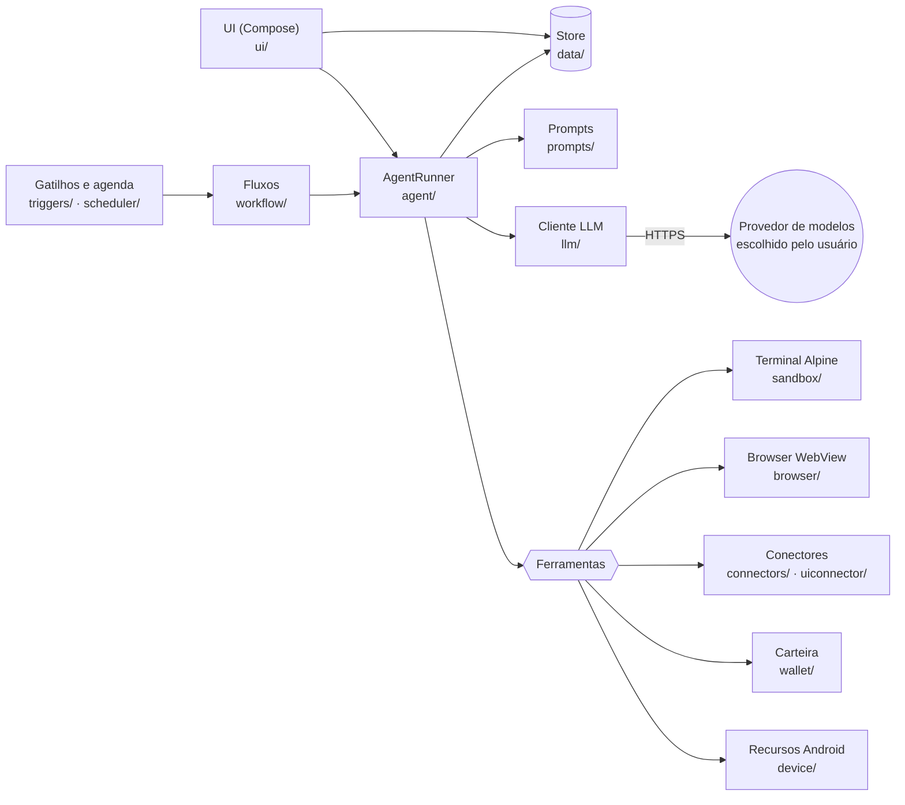

# Fluwy

**Fluwy** é um agente autônomo para Android, feito em Kotlin e Jetpack Compose, com um computador próprio dentro do aparelho:
terminal Linux (Alpine via proot), browser real (WebView), arquivos e conectores.
Não há login nem servidor do Fluwy: os dados ficam no aparelho e o modelo de linguagem é o provedor que o usuário configurar.

<p align="center"><code>Android 8+ (minSdk 26) · Kotlin 2 · Jetpack Compose · JVM 17</code></p>

---

## Sumário
- [Recursos](#recursos)
- [Arquitetura](#arquitetura)
- [Estrutura do código](#estrutura-do-código)
- [Prompts editáveis](#prompts-editáveis)
- [Como compilar](#como-compilar)
- [Testes e CI](#testes-e-ci)
- [Segurança e privacidade](#segurança-e-privacidade)
- [Contribuindo](#contribuindo)
- [Licenças de terceiros](#licenças-de-terceiros)

## Recursos

| Área | O que faz |
|---|---|
| **Agentes** | Perfis com nome, mascote, instruções, modelo, skills, memória e permissões próprias. Modo autônomo com heartbeat. |
| **Seções (times)** | Coordenador e membros trabalham num plano compartilhado, com delegação, revisão e entrega validada. |
| **Computador local** | Terminal Alpine (proot), browser WebView com abas, gerenciador e editor de arquivos por sessão. |
| **Conectores** | MCP, UI Connectors (YAML e criados com IA), hub de conectores e Web APIs (API Hub) com streaming. |
| **Fluxos** | Editor visual de automações com gatilhos (agenda, WhatsApp, webhook local), nós de IA, atendente e conectores. |
| **Memória** | Memória de longo prazo, base de conhecimento, notas por tarefa e compactação automática do contexto. |
| **Voz** | Voz local (Piper/VITS via sherpa-onnx), conversa ao vivo e respostas faladas. |
| **Carteira** | Carteira Solana local com política de aprovação, limites por agente e frase de recuperação cifrada. |
| **Prompts** | Todos os textos enviados aos modelos podem ser editados em *Configurações > Prompts*. |
| **Backup** | Exportação e importação cifradas dos dados do app. |

## Arquitetura



**Ciclo do agente.** A cada passo, o `AgentRunner` monta o prompt de sistema (`AgentPrompts.kt`) e escolhe só as ferramentas e o contexto relevantes (`ToolContextPlanner`). Depois chama o modelo, executa as ferramentas pedidas (`AgentToolDispatch.kt`) e grava tudo na sessão. Proteções contra loops, truncamento e repetição ficam em `AgentLoop.kt`.

**Terminal.** O app roda o `proot` empacotado em `jniLibs` com um rootfs Alpine. O agente usa a ferramenta `shell`; a aba Terminal usa um servidor PTY (`axs`) e o xterm.js num WebView. O `targetSdk 28` permite executar binários dentro do sandbox.

## Estrutura do código

Pacote raiz: `app/src/main/java/dev/fluwy/app`. Cada pasta é uma feature com uma responsabilidade.

| Pasta | Responsabilidade |
|---|---|
| `agent/` | Ciclo do agente, seções e times, ferramentas, contexto e memória. `AgentRunner` é a fachada pública; o resto são extensões internas por tema (`AgentLoop`, `AgentPrompts`, `AgentToolSchemas`, `AgentToolDispatch`, `AgentSections`, `AgentTeamPlan`…). |
| `prompts/` | Catálogo de todos os prompts (`PromptCatalog`, `Defaults*.kt`), motor de template e personalizações do usuário. |
| `llm/` | Cliente compatível com OpenAI, catálogo de provedores, fallback e recuperação de falhas. |
| `data/` | Modelos e `Store` (estado em JSON local). |
| `sandbox/` | Instalação do Alpine, execução de comandos e terminal. |
| `browser/` | `BrowserHost` (WebView e automação), API Hub e WhatsApp Web. |
| `connectors/`, `uiconnector/` | Conectores MCP, hub de conectores e UI Connectors. |
| `workflow/`, `triggers/`, `scheduler/` | Fluxos, gatilhos e tarefas agendadas (WorkManager). |
| `wallet/`, `trading/`, `vault/` | Carteira Solana, conectores de trading e cofre de segredos. |
| `device/`, `voice/`, `live/` | Recursos do Android (com opt-in por agente), voz e conversa ao vivo. |
| `backup/`, `files/`, `pages/`, `skills/` | Backup, arquivos, páginas compartilhadas e skills. |
| `ui/` | Telas Compose, uma pasta ou arquivo por tela (`ui/settings/`, `ui/theme/`, `ui/mascot/`…). |

Outros módulos: `terminal-emulator/` e `terminal-view/` (emulador de terminal). Também há `tools/` (scripts de CI: mini-hub de conectores, bots e pipeline de voz) e `docs/` (pesquisas e modelos de ameaça).

## Prompts editáveis

Os textos enviados aos modelos ficam no pacote `prompts/`:

- `PromptCatalog` lista cada prompt com id, grupo, título, descrição e texto padrão.
- O código usa só `Prompts.render(id, vars, flags)` e nunca strings soltas.
- Template: `{{nome}}` recebe um valor e `{{#flag}}…{{/flag}}` / `{{^flag}}…{{/flag}}` são trechos condicionais.
- O usuário edita, salva ou restaura cada prompt em **Configurações > Prompts**. As edições ficam em `filesDir/prompts/<id>.md`.

Para adicionar um prompt, crie a entrada num `Defaults*.kt` e chame `Prompts.render("seu_id", …)`.

## Como compilar

Requisitos: JDK 17 e Android SDK 35.

```bash
./gradlew assembleDebug          # APK de debug
./gradlew testDebugUnitTest      # testes JVM
```

Na primeira build, a task `downloadXterm` baixa o xterm.js para `app/src/main/assets/terminal/`.
No primeiro uso, o app pede a chave de um provedor de modelos e instala o sandbox Alpine (cerca de 3 MB mais pacotes).

**Assinatura de release** (opcional), por variáveis de ambiente:
`FLUWY_KEYSTORE_PATH`, `FLUWY_STORE_PASSWORD`, `FLUWY_KEY_ALIAS`, `FLUWY_KEY_PASSWORD`.

## Testes e CI

| Workflow | Função |
|---|---|
| `debug-apk.yml` | Testes JVM e APK de debug instalável (artefato `fluwy-bot-debug-apk-N`). |
| `build.yml` | Build de release. |
| `unit-tests.yml` | Validação dos conectores a cada push na `main`. |
| `minihub.yml`, `webapi-test.yml`, `wa-check.yml` | Verificação real de conectores, Web APIs e WhatsApp Web. |
| `voice-*.yml`, `phonon-model.yml` | Pipeline de modelos de voz. |

Testes JVM em `app/src/test`, testes instrumentados em `app/src/androidTest`.

## Segurança e privacidade

- Não há conta nem servidor próprio. As chamadas de rede vão para o provedor de modelos e para os serviços que o usuário conectar.
- Credenciais de conectores ficam cifradas no Android Keystore (AES-GCM) e nunca são enviadas ao modelo.
- O agente não digita senhas, códigos 2FA nem dados de cartão; logins são feitos pelo usuário.
- A carteira exige aprovação explícita e respeita os limites definidos por agente. O CVV nunca é guardado.
- Conteúdo de sites, arquivos e ferramentas entra no prompt marcado como dado não confiável (`PromptContextPolicy`).

Detalhes em `docs/wallet-threat-model.md` e `docs/solana-wallet-security.md`.

## Contribuindo

Leia o [`AGENTS.md`](AGENTS.md): convenções de código, estrutura e como validar uma mudança.
Commits em português, no formato `tipo(escopo): resumo` (`feat`, `fix`, `refactor`, `docs`, `test`).

## Licenças de terceiros

- `init-sandbox.sh` e os binários `libproot*.so`, `libtalloc.so` e `libaxs.so` vêm do [Acode](https://github.com/Acode-Foundation/Acode) (MIT) e do [acodex_server](https://github.com/bajrangCoder/acodex_server).
- O proot é GPL-2.0 e é distribuído como binário separado, sem linkagem.
- O xterm.js é MIT. O emulador de terminal (`terminal-emulator/`, `terminal-view/`) vem do Termux; veja as licenças nesses módulos.
