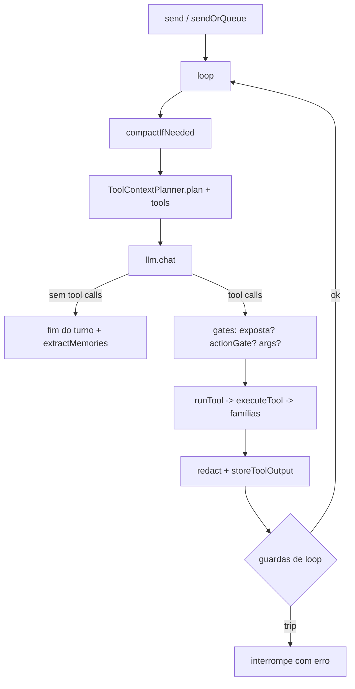

# Loop do agente

## Propósito

O loop do agente é o núcleo de execução do Fluwy: recebe a mensagem do usuário, monta o contexto (system prompt, histórico, ferramentas), chama o LLM, executa as chamadas de ferramenta devolvidas e repete até o modelo concluir, pausar ou ser interrompido por uma guarda.

## Arquivos principais

| Arquivo | Papel |
|---|---|
| `agent/AgentRunner.kt` | Fachada pública: `send`, `sendOrQueue`, `stop`, `stopAndDeliver`, fila de mensagens, aprovações (`decideApproval`), perguntas, formulários seguros, seções e autonomia (`startAutonomy`). |
| `agent/AgentLoop.kt` | `AgentRunner.loop(sessionId, maxStepsOverride, tokenBudgetOverride)` — o ciclo LLM → ferramentas. Também `sleepAndWake`, `wakeUp`, `canBeat`. |
| `agent/ToolContextPlanner.kt` | Decide quais grupos de ferramentas, conectores e servidores MCP entram em cada passo, e o orçamento de knowledge/memórias. |
| `agent/AgentToolSchemas.kt` | `AgentRunner.tools(...)` monta o array JSON de ferramentas expostas. |
| `agent/AgentToolDispatch.kt` | `runTool` (ferramentas de orquestração: seções, time, agenda, perguntas, `finish`) e `executeTool` (famílias). |
| `agent/ToolInvocation.kt` | Objeto com argumentos, sessão, passo de UI e helpers `s/i/b/sl` repassado às famílias. |
| `agent/ToolLoopDetector.kt`, `RepeatedToolFailureGuard.kt`, `AgentFileToolFailureGuard.kt` | Guardas de loop. |
| `agent/ContextManager.kt`, `ContextPruner.kt`, `CompactionProgress.kt` | Compactação de contexto. |
| `agent/ToolExecutionManager.kt` | Registro de execuções (QUEUED/RUNNING/COMPLETED/FAILED/CANCELLED); guarda os últimos 12 000 caracteres da saída. |

## Fluxo passo a passo

1. `AgentRunner.send` / `sendOrQueue` registra a mensagem; se a sessão já roda, ela vai para a fila (`QueuedMessage`) e é drenada depois (`drainQueueInto`, `flushQueueIfIdle`).
2. `loop` calcula `maxSteps` (`settings.maxSteps` ou override; limitado a 15 em "entrega final").
3. A cada volta do `while (scope.isActive)`:
   - Se for um worker com `tokenBudgetOverride`, verifica o orçamento de tokens.
   - `ctxMgr.compactIfNeeded(s)`; em exceção, registra no `ErrorLog` e usa corte seguro. Se houve compactação, arma `toolLoops.armPostCompaction()`.
   - Monta ferramentas (`tools(...)`), carrega grupos fixos (`web_dev` para builders, `pages` em seções) e gera o `ToolContextPlanner.Plan`.
   - Monta o system prompt e chama `llm.chat(...)` com retentativas; erro de contexto estourado (`LlmRecovery.Category.CONTEXT`) força compactação. Falha definitiva agenda auto-retomada (`scheduleAutoResume`).
   - Nomes de ferramenta passam por `ToolAliases.resolve` e `squadFixArgs`.
   - Resposta sem ferramentas: detecção de repetição de texto, de "anúncio de ação sem executar" e de turno vazio; senão o turno termina e `extractMemories` roda em segundo plano.
   - Para cada `toolCall`: checa se foi exposta (senão `RECUSADO`), `repeatGuard`/`actionGate` (aprovação), `toolArgsGuard`, `squadModeGuard`, snapshots de acessibilidade inválidos, e então `ledgerRun { runTool(...) }`.
   - Saídas passam por `SecretVault.redact`, são armazenadas via `ContextManager.storeToolOutput` e alimentam as guardas.
4. Ao atingir `maxSteps`: sessões contínuas dormem (`sleepAndWake`, 60 s) e zeram o contador; as demais recebem "Limite de N passos atingido. Envie \"continue\" para seguir.".

## ToolContextPlanner

- `GROUPS`: `core`, `web_dev`, `agents`, `build`, `workflow`, `schedule`, `channels`, `cofre`, `pages`, `live`, `skills_admin`, `wallet`, `device`, `connector_builder`.
- Um grupo entra se: palavra-gatilho do pedido (`TRIGGERS`, texto normalizado sem acento), ferramenta do grupo já usada, grupo carregado antes via `tools_load` (pegajoso por sessão em `loaded`) ou modo construtor.
- Conectores entram por nome/id/descrição (≥2 palavras em comum) ou uso anterior; "use o conector…" sem nome expõe todos.
- Orçamento: espaço livre > 60% → fator 1.0; > 30% → 0.6; senão 0.35. Knowledge = 4500×fator caracteres, memórias = 2400×fator, skills mostradas 20 ou 10.

## Guardas de loop

- `ToolLoopDetector` (janela 24): `SAME_CALL`, `SAME_CONTENT`, `PING_PONG` (6 chamadas), `NO_PROGRESS` (14), `UNKNOWN_TOOL` (3), `POST_COMPACTION` (3 chamadas após compactar).
- `RepeatedToolFailureGuard`: mesma chamada com a mesma falha (saída começando com `ERRO`, `ERROR`, `Erro:`, `❌`, `Falha`) avisa na 3ª e encerra na 5ª.
- `AgentFileToolFailureGuard`: falhas determinísticas de arquivo repetidas.
- `CompactionProgress`: 3 compactações sem liberar espaço encerram com erro.
- Após `actionGate` pedir confirmação, demais chamadas da mesma resposta voltam `NÃO EXECUTADO`.

## Compactação

Ver [memory-and-knowledge.md](memory-and-knowledge.md). Em resumo: limpeza de resultados antigos a 60% do `contextBudget`, poda sem LLM, resumo estruturado pelo modelo rápido, circuit breaker por trechos literais.

## Dispatch e famílias

`runTool` trata orquestração (`create_section`, `team_*`, `cron_*`, `set_schedule`, `sleep`, `ask_*`, `tools_load`, `finish`…). O restante cai em `executeTool`, que cria `ToolInvocation` e tenta em ordem `walletTools ?: workspaceTools ?: browserTools ?: deviceTools`; depois um `when` final (`build_team`, `workflow_manage`, `multi_agents`, `live_server`…). Exceções viram `ToolResult` de erro; o loop nunca cai por falha de ferramenta.

## Persistência

Sessão (`llm`, `summary`, `compactions`) via `Store`; saídas longas em `.fluwy/out`; resumos em `.fluwy/compactions/compact_N.md`; erros no `ErrorLog`.

## Segurança

- Ferramentas não expostas no passo são recusadas sem execução.
- `actionGate` exige aprovação do usuário para ações sensíveis.
- Coordenador de seção perde terminal/browser/Android (ver [sections-and-teams.md](sections-and-teams.md)).
- Saídas de acessibilidade não são persistidas no histórico.

## Como estender

- Nova regra de grupo: adicione ao `GROUPS`/`TRIGGERS` de `ToolContextPlanner`.
- Nova guarda: siga o padrão de `RepeatedToolFailureGuard` (classe pura, testável) e consulte-a no laço de `AgentLoop`.

## Limitações conhecidas

- Seleção de grupos por palavra-chave pode falhar em pedidos sem termos esperados; o modelo depende de `tools_load`.
- Estimativa de tokens é heurística (`chars / 3.2 + 4`).
- `AgentLoop.kt` concentra muita lógica num único `loop` (~700 linhas).
