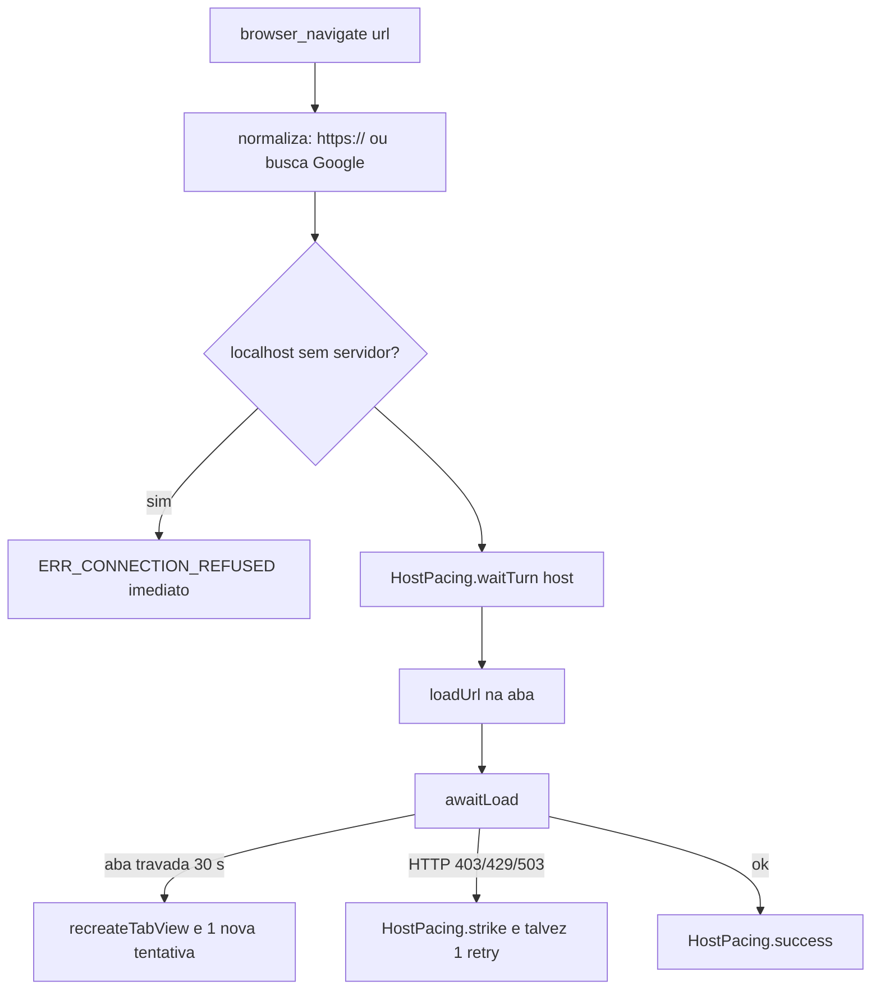

# Browser do agente

## Propósito

Browser embutido baseado em WebView, com múltiplas abas isoladas por conversa. A aba ativa é compartilhada entre a UI (aba Browser) e as ferramentas `browser_*`: o usuário vê ao vivo o que o agente faz e pode assumir o controle tocando na página.

## Arquivos principais

| Arquivo | Papel |
|---|---|
| `browser/BrowserHost.kt` | Classe `BrowserHost(appCtx, sessionId)`: abas, estado de UI (`Ui`), rede (`NetEntry`), console (`ConsoleEntry`), leitura, `waitFor`, `diagnostics`, `HostPacing`. |
| `browser/BrowserHostViews.kt` | `createView`: `WebViewClient`/`WebChromeClient`, página de erro própria, instrumentação de rede e snapshot, `sync`, persistência do estado do WebView. |
| `browser/BrowserHostNavigation.kt` | `navigateInTab`, `awaitLoad`, `waitForStable`, `readiness`, `collectTimings`, tema escuro. |
| `browser/BrowserHostPage.kt` | `eval` (JS com timeout de 15 s), `staleRefRecovery`, `awaitLoadIfNavigating`, `onMain`. |
| `browser/BrowserSessionPersistence.kt` | Abas/histórico por chat (`MAX_TABS = 12`). |
| `browser/OffscreenStage.kt` | "Palco" fora da tela para o WebView navegar com a aba Browser fechada. |
| `browser/SnapshotFormat.kt`, `BrowserPolicies.kt`, `LoopbackEndpointProbe.kt`, `DemoRecorder.kt` | Formato do snapshot, políticas, sonda TCP de localhost, gravação de demonstração. |
| `agent/AgentBrowserTools.kt` | Mapeia `browser_*` para métodos do host. |

## Abas

- `createTab`, `selectTab`, `closeTab`; para o agente: `newTab`, `selectTabForAgent`, `closeTabForAgent` (ferramentas `browser_new_tab/select_tab/close_tab`).
- Até 12 abas por conversa; no máximo `MAX_LIVE_VIEWS = 3` WebViews vivos. Abas ociosas são "estacionadas" (`parkTab`: histórico salvo, WebView liberado) e recriadas sob demanda.
- Perfil WebView compartilhado entre chats (logins compartilhados); abas e histórico ficam por chat. Sem suporte a perfil isolado, a navegação externa é bloqueada (`PROFILE_ISOLATION_UNAVAILABLE`).
- `signOutEverywhere` apaga cookies/armazenamento do perfil de contas.

## Fluxo de navegação

`awaitLoad` (estilo Playwright): primeiro sinal do WebView (até 30 s) → DOMContentLoaded (10 s) → `load` (5 s) → estabilidade (8 s). `waitForStable` exige ≥500 ms, rede ociosa (rastreadores e polling > 10 s ignorados) ou 1,5 s sem rede, DOM parado há 700 ms, texto visível, em 2 leituras seguidas. Lentidão não vira erro se houver conteúdo.

Casos especiais: URLs `.json` do Reddit têm o sufixo removido; sem janela (display virtual recusado e sem permissão de sobreposição) a navegação é abortada com orientação.

## HostPacing

Objeto global (todos os chats): intervalo mínimo de 2,5 s entre aberturas do mesmo host, espera máxima 45 s. Após bloqueio: recuo de 10 s, 30 s, 60 s, depois 120 s×(n−3) até 5 min. Sucesso zera.

## Leitura e interação

- `browser_read`/`browser_snapshot`: snapshot semântico (landmarks, headings, links, controles indexados), `max_chars` 1000–20000 (padrão 9000).
- `browser_click(index)`, `browser_type(index, text, submit)`, `browser_scroll`, `browser_back`, `browser_wait_for` (texto aparecer/sumir, até 30 s).
- Índice velho: `staleRefRecovery` devolve o snapshot novo junto com o erro.
- `browser_js` roda JS na aba (texto passa por `SecretVault.resolve`).
- `captureJpeg` para páginas sem texto (canvas).

## Captura de rede e console

- Após cada navegação, `installNetworkInstrumentation` instrumenta `fetch` e `XMLHttpRequest` (sem proxy/VPN), guardando método, headers, corpo (até 12 000 chars), status e duração; `mergeCapturedNetwork` traz para Kotlin e `collectTimings` completa com a Resource Timing API.
- Buffer de 500 requisições (lote a cada 100 ms); console guarda 300 mensagens.
- `browser_network(filter)`: últimas 60 da aba ativa, com headers (até 1500 chars) e payload/resposta (até 3000).
- `browser_console`: últimas 60 mensagens da aba ativa.
- Painel Rede da UI usa os mesmos dados.

## Persistência

`persistState` (no `onStop` da Activity) salva perfil e histórico; `BrowserSessionPersistence` guarda abas por chat; `clearSessionData` limpa por sessão.

## Segurança

- `onPermissionRequest`/geolocalização passam por `BrowserPermissions`.
- Falhas de browser vão ao `ErrorLog` com `diagnostics()` (linha do tempo, redirecionamentos, requisições pendentes).
- Modo leve (`liteMode`) após 2+ quedas do renderizador em 5 min.

## Como estender

Nova ferramenta: método `suspend` no `BrowserHost` (ou extensão em `BrowserHost*.kt`), case em `AgentBrowserTools.kt`, schema em `AgentToolSchemas.kt` e grupo em `ToolContextPlanner`.

## Limitações conhecidas

- `browser_network` mascara cabeçalhos de credencial (`Authorization`, `Cookie`, `Set-Cookie`, chaves de API) e tokens conhecidos nos corpos; outros dados da página continuam visíveis ao modelo.
- Captura de rede vê apenas `fetch`/XHR instrumentados após a navegação; requisições iniciais e de outros mecanismos dependem do `shouldInterceptRequest`/Resource Timing.
- `HostPacing` é em memória e global; reinício do app zera os recuos.
