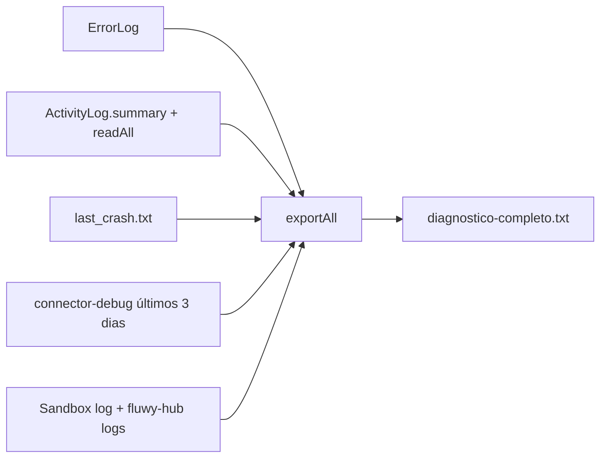

# Diagnóstico e logs

## Propósito

Registrar falhas reais e atividade do app em arquivos locais limitados, para o usuário consultar na tela de Logs e exportar um diagnóstico completo, sem incluir segredos.

## Arquivos principais

| Arquivo | Papel |
|---|---|
| `diag/ErrorLog.kt` | Log de erros em JSONL (`filesDir/error_log.jsonl`), dedupe, redação, `exportAll`. |
| `diag/ActivityLog.kt` | Log de atividade em texto (`filesDir/activity_log.txt`): ferramentas, Web APIs, chamadas LLM; `summary`. |
| `diag/ConnectorDebugLog.kt` | Logs rotativos por conector (`filesDir/connector-debug/`), só metadados sanitizados. |
| `diag/ChatDataExport.kt` | Exportação "Dados" em JSON (`fluwy-dados-chats.json`). |
| `ui/settings/ErrorLogsScreen.kt` | Tela de Logs (rota `error_logs`). |
| `ui/SettingsScreen.kt` | Botões de exportação e exibição do último crash. |
| `FluwyApp.kt` | Handler de crash grava `last_crash.txt`. |

## ErrorLog

Formato de cada linha (`ErrorLog.Entry`):

```json
{"ts":0,"source":"agent","message":"...","type":null,"stack":null,"tool":"shell","session":"abcd1234","count":1}
```

- `source`: área (`agent`, `browser`, `sandbox`, `llm`, `workflow`, `heartbeat`, `crash`…).
- `log(source, detail, sessionId, tool)`: mensagem até 2000 chars (6000 para `browser`); stack separada (linhas `at …`) até 4000; sessão truncada a 8 chars.
- `log(source, Throwable, …)`: inclui tipo e stack.
- Dedupe: mesma `source|tool|mensagem[0..200]` em até 30 s, entre as últimas 20 linhas, incrementa `count` em vez de nova linha.
- Limite 768 KB: ao passar, mantém a metade mais recente das linhas.
- `entries(limit=500)` mais recentes primeiro; `render` gera texto legível.
- `redact` aplicado antes de gravar (ver [vault-and-secrets.md](vault-and-secrets.md)).

### Quem grava

O loop do agente (falhas de LLM, compactação, loops interrompidos), `executeTool` (saídas `ERRO:`/`[exit N]`/marcadores; browser inclui `diagnostics()`), navegação do browser, heartbeat, entre outros. Acessibilidade grava apenas mensagem genérica por privacidade. Sondagens benignas do shell (`exit 1/7/22` curtas) não são registradas.

## ActivityLog

Linha: `[MM-dd HH:mm:ss.SSS] kind   sess=xxxxxxxx ok|ERRO nome Nms · …`.

- `tool(...)`: args resumidos (160 chars) e resultado (260).
- `webApi(...)` e `llm(...)`.
- Limite 1 MB: corta a metade mais antiga.
- `summary`: por ferramenta/API/modelo, execuções, falhas, % e tempo médio, ordenado por falhas.

## Fluxo de exportação



`exportAll` monta seções: cabeçalho (versão, aparelho, Android, ABI), resumo por ferramenta, erros, atividade (últimos 250 000 chars), último crash, conectores usados nos últimos 3 dias (4000 chars cada), log do Linux (15 000) e logs do hub (`install.log`, `hub.log`, `redis.log`).

`ChatDataExport.export` gera JSON `fluwy-dados/1` com schemas de ferramentas, agentes, seções, sessões completas (itens e mensagens ao modelo), build squads e os últimos 400 000 chars do log de erros. Exclui configurações/chaves, cofre, carteira e logins.

## Tela de Logs

`ErrorLogsScreen`: filtro por `source` (chips com contagem), lista com botão "Copiar" por entrada e "Limpar". Configurações oferece exportar/compartilhar o diagnóstico completo e os "Dados".

## Segurança

- Redação por padrões no ErrorLog; saídas de ferramentas já passam por `SecretVault.redact`.
- Conteúdo de tela de acessibilidade não é gravado.
- `ConnectorDebugLog` nunca aceita corpos nem valores de headers.

## Como estender

- Nova área: use um `source` novo em `ErrorLog.log`; aparece automaticamente como filtro.
- Nova métrica de atividade: adicione função em `ActivityLog` seguindo o formato `kind ok|ERRO nome Nms` para entrar no `summary`.

## Limitações conhecidas

- O botão "Limpar" da tela de Logs apaga só os erros (`ErrorLog.clearErrors`); a limpeza completa (`ErrorLog.clear`) também remove `activity_log.txt` e `last_crash.txt`.
- `ChatDataExport` contém o conteúdo integral das conversas, ao contrário do diagnóstico completo; deve ser compartilhado com cuidado.
- Dedupe reescreve o arquivo inteiro a cada repetição (custo O(n) em arquivo de até 768 KB).
- O KDoc do `ErrorLog` diz que o conteúdo de conversas nunca entra, mas mensagens de erro podem citar trechos de saídas de ferramentas.
