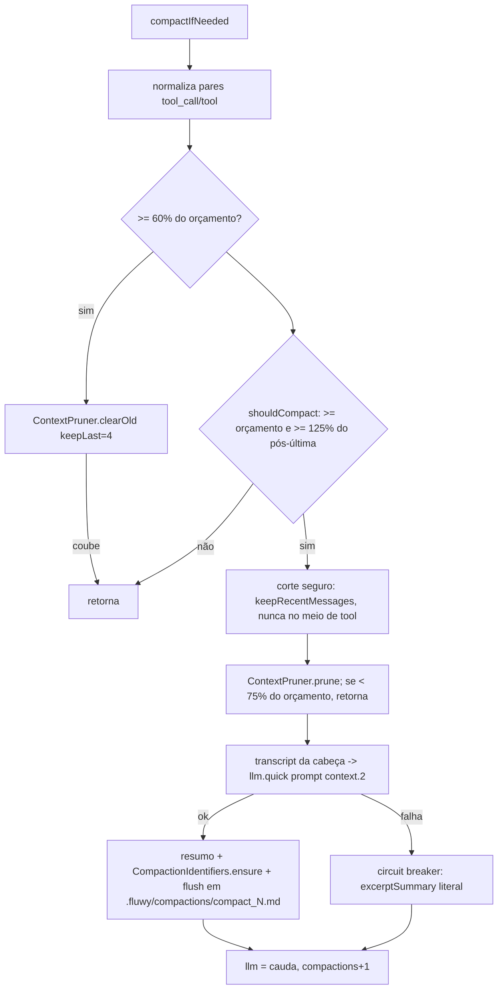

# Memória, knowledge e contexto

## Propósito

Manter sessões longas dentro do orçamento de contexto sem perder estado, e dar ao agente memória persistente (fatos sobre o usuário e projetos), documentos de knowledge e anotações por tarefa, sempre recuperados por relevância.

## Arquivos principais

| Arquivo | Papel |
|---|---|
| `agent/ContextManager.kt` | Arquitetura em 3 camadas: micro-compactação, compactação estrutural, memória persistente. `CompactionIdentifiers` no mesmo arquivo. |
| `agent/ContextPruner.kt` | Encurtamento/remoção de resultados antigos de ferramentas sem LLM. |
| `agent/MemoryHygiene.kt` | Funções puras: checagem anti-alucinação, validade (`· até AAAA-MM-DD`), histerese de compactação, resumo literal de emergência, recall de conversas anteriores. |
| `agent/MemoryGraph.kt` | "Segundo cérebro": títulos, categorias, `[[wikilinks]]`, arestas, layout do grafo. |
| `agent/MemoryGate.kt` | Decide se vale extrair memórias (o usuário disse algo duradouro). |
| `agent/MemoryRecallPolicy.kt` | Seleção determinística por escopo, relevância e orçamento. |
| `agent/ContextOutputRetentionPolicy.kt` | Limpeza de `.fluwy/out` preservando arquivos referenciados (idade mínima 12 h). |
| `data/Models.kt` | `MemoryItem` (text, agentId, tags, uses, title, kind, links) e `KnowledgeItem` (title, content, enabled). |
| `ui/MemoryScreen.kt`, `ui/MemoryGraphView.kt` | Tela de memórias e visualização em grafo. |

## Camada 1 — saídas de ferramenta

- `storeToolOutput`: saída acima do limite (padrão 8000) é arquivada em `/root/workspace/.fluwy/out/o<hash>_<len>.txt` (nome pelo conteúdo, sem duplicatas) e o contexto recebe início + fim + ponteiro para `file_read`.
- Saídas de acessibilidade (`persistLongOutput=false`) nunca são arquivadas.
- Snapshots de browser arquivados são marcados; `file_read` recusa relê-los quando antigos (`staleBrowserSnapshotMinutes`).
- `microCompact`: mantém as 6 últimas respostas de ferramentas inteiras; antigas (>240 chars) viram resumo com ponteiro.

## Camada 2 — compactação estrutural

- Transcript: resultados de ferramenta projetados em início+fim (2000 chars), usuário 2000, assistente 1500; acessibilidade omitida; total ≤ 60 000 chars.
- `CompactionIdentifiers` extrai URLs, caminhos, IDs e marcadores de segredo e garante que sobrevivam literalmente no resumo.
- `safeTrim` (sem LLM) e `hardShrink` (encurta resultados recentes, no limite fica com as 4 últimas) são planos B.
- Estimativa de tokens: `chars / 3.2 + 4`.
- Guardas no loop: ver [agent-loop.md](agent-loop.md) (`CompactionProgress`, `POST_COMPACTION`).

## Camada 3 — memória persistente

### NOTES.md

`notes_write(content, append=true)` grava `NOTES.md` no workspace da tarefa; `readNotes` injeta no prompt.

### Memórias

- `memory_save(fact, scope, tags, title, kind, links)`: máximo 500 chars (erro explícito acima). Escopo global ou do Agent (`scope="agent"`).
- Deduplicação: mesmo agente e Jaccard ≥ 0,7 atualiza a existente (texto mais longo, tags unidas, até 8 links).
- Limite de 400 memórias: remove as menos usadas e mais antigas.
- Categorias (`KINDS`): pessoa, projeto, trabalho, preferencia, ferramenta, lugar, rotina, outro.
- Recuperação: `relevantMemories(query, agentId, k=8, maxChars=2400)` filtra memórias ativas (`MemoryHygiene.active`), ranqueia por palavras/tags/uso e expande com vizinhos do grafo; `touch` incrementa uso. `memory_search` usa k=15.
- Extração automática: ao concluir um turno, `extractMemories` (modelo rápido, prompt `context.1`) só roda se a conversa tem ≥200 chars e `MemoryGate.worthExtracting`; aceita até 5 fatos de 8–400 chars que passem em `factBackedByUser` (números, URLs e caminhos precisam ter sido ditos pelo usuário).

### Knowledge

`relevantKnowledge(query, k=5, maxChars=4500)`: itens `enabled`, ranqueados e truncados. O orçamento real vem do `ToolContextPlanner` (fator 1.0/0.6/0.35 conforme o espaço livre).

### Conversas anteriores

`MemoryHygiene.pastChats` busca palavras do pedido em títulos/resumos de outras sessões (k=2, 1200 chars; pedidos longos exigem ≥2 termos em comum).

## MemoryGraph

Arestas explícitas (`links` + `[[wikilinks]]`) e automáticas (tags e palavras em comum, Jaccard). `layout` é um force-directed com sementes por categoria (seed fixa = layout estável).

## Segurança

- Conteúdo de memórias anteriores e resumos entra no prompt como bloco não confiável (`PromptContextPolicy.untrustedBlock`).
- Conteúdo de tela de acessibilidade não vai para resumos nem arquivos.

## Como estender

- Nova categoria: `MemoryGraph.KINDS` (e palavras de inferência em `kindOf`).
- Ajuste de compactação: `settings.contextBudget`, `settings.keepRecentMessages`, `Session.autoCompact`.

## Limitações conhecidas

- `knowledge_search` e `notes_read` aparecem em listas de política (`contentTool`, `POST_COMPACTION_READS`), mas não há `case` de execução para eles no dispatch.
- Relevância é lexical (palavras normalizadas), sem embeddings.
- Dedup por Jaccard pode fundir fatos parecidos porém distintos.
