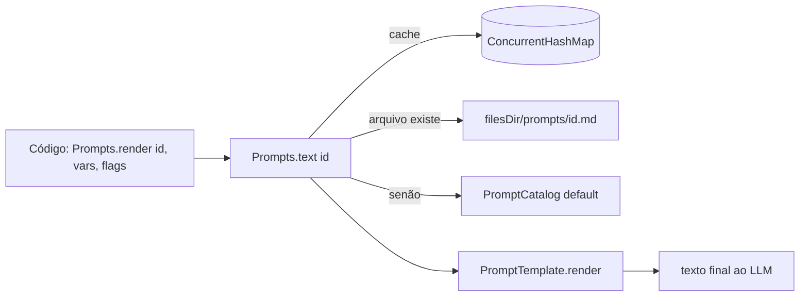

# Prompts editáveis

## Propósito

Centralizar todos os textos enviados aos modelos (system prompt do agente, compactação, extração de memória, conectores, fluxos, voz, agentes do catálogo, browser) num catálogo com padrões versionados no código e permitir que o usuário personalize cada um em **Configurações > Prompts**.

## Arquivos principais

| Arquivo | Papel |
|---|---|
| `prompts/PromptCatalog.kt` | `PromptDef(id, group, title, description, default)` e `PromptCatalog.all/byId`. |
| `prompts/Prompts.kt` | Ponto único de acesso: `init`, `text`, `render`, `isCustomized`, `save`, `reset`. |
| `prompts/PromptTemplate.kt` | Motor de template (subconjunto de Mustache) e `placeholders`. |
| `prompts/DefaultsAgente.kt` | 164 prompts/trechos do grupo "Agente". |
| `prompts/DefaultsMemoriaEContexto.kt` | 2 ("Memória e contexto", ex.: `context.1` extração, `context.2` compactação). |
| `prompts/DefaultsConectores.kt` | 9 ("Conectores"). |
| `prompts/DefaultsFluxos.kt` | 16 ("Fluxos", ex.: `workflow.10`–`workflow.16`). |
| `prompts/DefaultsVoz.kt` | 3 ("Voz", `live_voice.*`). |
| `prompts/DefaultsAgentesDoCatalogo.kt` | 12 ("Agentes do catálogo"). |
| `prompts/DefaultsBrowser.kt` | 7 ("Browser"). |
| `ui/settings/PromptsScreen.kt` | `PromptsScreen` (lista) e `PromptEditorScreen` (edição). |

## Modelo

- `id` com ponto (ex.: `agent_system.3`, `runner.34`) indica **fragmento** (`isFragment`) de um prompt maior montado em código conforme o contexto.
- `group` define a seção na tela; a ordem do catálogo é a ordem de exibição.
- Os arquivos `Defaults*.kt` foram gerados a partir dos prompts originais; editar `default` muda o padrão do app.

## Sintaxe de template

| Sintaxe | Efeito |
|---|---|
| `{{nome}}` | Substitui pela variável; ausente vira vazio. |
| `{{#flag}}…{{/flag}}` | Mantém o trecho só se a flag for verdadeira. |
| `{{^flag}}…{{/flag}}` | Mantém o trecho só se a flag for falsa. |

Regras adicionais:

- Tag de seção sozinha na linha não deixa linha em branco.
- Linha que tinha conteúdo e ficou vazia após a substituição é removida; linhas em branco originais ficam.
- Seções aninhadas são resolvidas em iterações até estabilizar.
- Nomes: `[A-Za-z0-9_]+`.
- Para escrever `{{` literal no texto, os chamadores passam a variável `lb = "{{"` e o prompt usa `{{lb}}` (ex.: `Prompts.render("runner.34", mapOf("lb" to "{{"))`).

## Fluxo

- `Prompts.init(filesDir)` é chamado em `FluwyApp`; cria `filesDir/prompts/` e limpa o cache.
- Sem `init` (testes JVM) valem sempre os padrões.
- `render` converte valores para `String` (`null` → vazio).

## Configurações > Prompts

- Lista todos os prompts por grupo, marcando os personalizados. Toque abre o editor.
- O editor avisa quando o texto não usa algum placeholder do padrão ("Atenção: o texto não usa {{x}}").
- **Salvar**: grava `filesDir/prompts/<id>.md`; se o texto for idêntico ao padrão, apaga o arquivo (volta a seguir o padrão).
- **Restaurar padrão**: apaga o arquivo e o cache, com confirmação.

## Persistência

Um arquivo Markdown por prompt personalizado. Atualizações do app mudam os padrões, mas não sobrescrevem personalizações.

## Segurança

- Conteúdo dinâmico não confiável (resumos anteriores, memórias existentes) é inserido pelos chamadores via `PromptContextPolicy.untrustedBlock`, não pelo template.
- Personalizar prompts do agente pode remover regras de segurança textuais; os guardrails de código (gates, `SecretVault`, `actionGate`) continuam valendo.

## Como estender

1. Adicione um `PromptDef` ao arquivo `Defaults*.kt` do grupo (id único; use ponto para fragmentos).
2. No código, chame `Prompts.render("<id>", mapOf(...), mapOf(...))` em vez de string fixa.
3. Novo grupo: crie `DefaultsX.kt` e inclua `DefaultsX.all` em `PromptCatalog.all`.

## Limitações conhecidas

- `Prompts.text` lança erro para id desconhecido (`Prompt desconhecido: <id>`); um id errado no código falha em tempo de execução.
- Personalização de um prompt não é migrada quando o padrão muda de placeholders; o aviso do editor é a única proteção.
- O cache não é invalidado se o arquivo for alterado fora do app.
