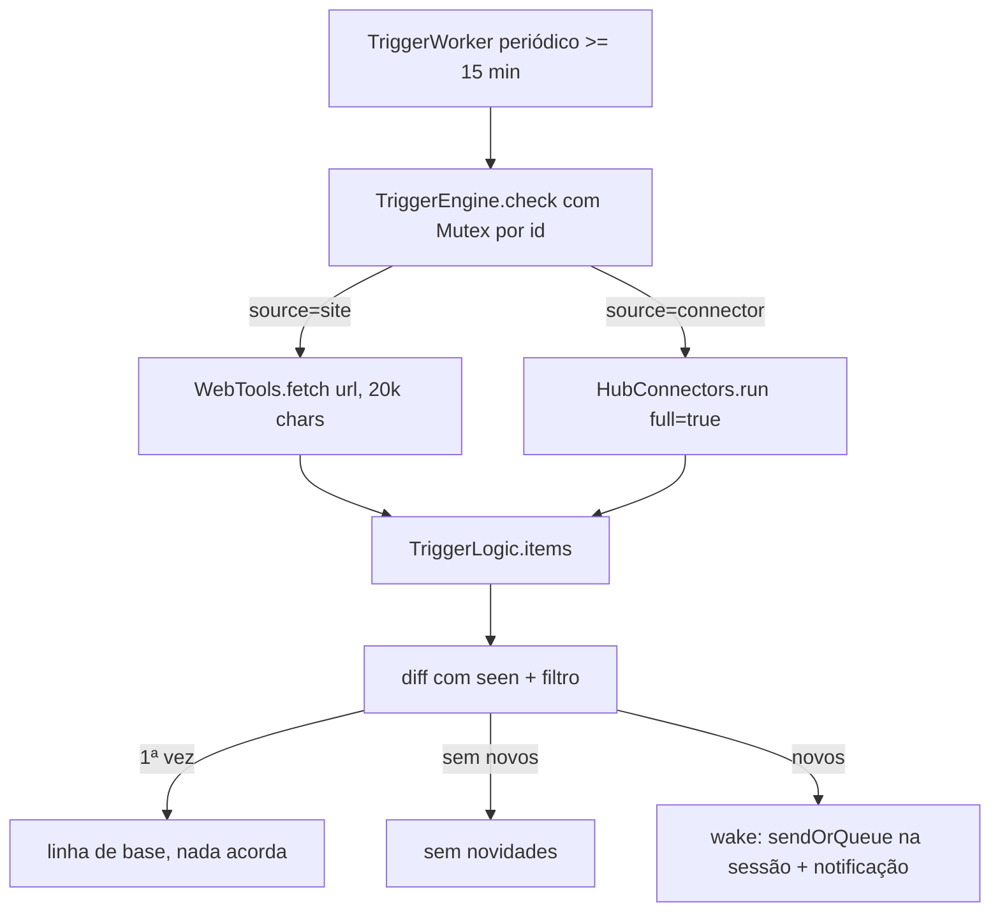

# Agendamento, gatilhos e autonomia

## Propósito

Executar trabalho do agente sem o usuário estar no chat: tarefas agendadas (prompts recorrentes), gatilhos que acordam uma sessão quando surge um evento novo, e agentes autônomos com heartbeat periódico. Os gatilhos de fluxos estão em [workflows.md](workflows.md).

## Arquivos principais

| Arquivo | Papel |
|---|---|
| `scheduler/Scheduler.kt` | `Scheduler` (tarefas agendadas via WorkManager), `ScheduledWorker`, `AutonomyWorker` (15 min), `BootReceiver`, `QuietRun`. |
| `scheduler/Heartbeat.kt` | Alarmes exatos por agente autônomo (`Heartbeat`) e `HeartbeatReceiver`. |
| `triggers/Triggers.kt` | `Trigger`, `TriggerStore` (SharedPreferences `fluwy_triggers`), `TriggerLogic` (puro), `TriggerEngine`, `TriggerWorker`. |
| `agent/AgentHeartbeat.kt` | `autonomyTick`, `startHeartbeatCycle`. |
| `agent/AgentRunner.kt` | `startAutonomy`, `triggerHeartbeatFromAlarm`. |
| `agent/AgentLoop.kt` | `canBeat`, `sleepAndWake`, `wakeUp`, `evaluateAllArmedRules`. |
| `agent/AgentToolDispatch.kt` | Ferramentas `cron_add/list/remove`, `set_schedule`, `sleep`, `trigger_create/list/delete`. |
| `ui/TriggersScreen.kt` | Tela de gatilhos. |

## Tarefas agendadas (Scheduler)

- `ScheduledTask` com `repeat`: `ONCE` → `OneTimeWorkRequest`; `HALF_HOUR`, `HOURLY`, `DAILY`, `WEEKLY` → `PeriodicWorkRequest` (nome único `sched_<id>`, política `UPDATE`).
- `ScheduledWorker`: cria sessão "⏰ título", chama `agent.send` com cabeçalho de horário local e a instrução de terminar com `QuietRun.MARKER` se não houver novidade; acompanha até terminar, parando se o worker for cancelado ou a execução deixar de estar ativa (`store.isScheduledRunActive`).
- Notificação: falha → aviso de falha; resposta com o marcador → notificação silenciosa "Execução sem novidades"; senão, se `settings.notifyOnDone`, "Tarefa agendada concluída".
- Agente cria via `cron_add` (`once`, `half_hour`, `hourly`, `daily`, `weekly`).

## Gatilhos (TriggerEngine)

- Fonte `connector`: ação de leitura de um conector do hub (`piece`, `action`, `input`, `connection`); itens = maior array do resultado; chave = campo id/messageId/uid ou hash SHA-256 (16 hex).
- Fonte `site`: cada trecho de texto da página (20 a 500 caracteres) vira um item, com chave que ignora números; só trechos novos acordam a sessão. Gatilhos antigos refazem a linha de base na primeira verificação.
- `seen` guarda os 500 ids mais recentes; `history` guarda 20 eventos.
- 3 falhas seguidas geram notificação de falha.
- `wake` envia à sessão existente (ou recria "⚡ nome") até 10 eventos (1500 chars cada) com a instrução e o lembrete de que ações externas exigem aprovação.

## Autonomia e heartbeat

- Agente autônomo: `AgentProfile.autonomous`, `homeSessionId`, `heartbeatMinutes`, janela `activeStartHour`–`activeEndHour`, `dailyTokenBudget`.
- `Heartbeat.schedule`: alarme exato (`setExactAndAllowWhileIdle`; inexato sem permissão) com `PendingIntent` por agente.
- `HeartbeatReceiver`: **reagenda primeiro** o próximo alarme, sobe `SandboxService` e chama `triggerHeartbeatFromAlarm` (sem bloquear o receiver).
- `canBeat` exige: autônomo, capacidade `BACKGROUND`, sessão-base ociosa, (opcionalmente) intervalo vencido, dentro da janela de horas e orçamento diário de tokens não esgotado (avisa uma vez por dia).
- `startAutonomy`: reagenda todos, inicia serviço em foreground se houver autônomos ou regras de trade armadas, e roda um laço a cada 5 s (`autonomyTick`) que também avalia regras de stop-loss/take-profit a cada ~20 s.
- `AutonomyWorker` (WorkManager, 15 min, `KEEP`) e `BootReceiver` religam tudo (inclusive alarmes de fluxos) após morte do processo ou reboot.
- `AppExit.exited` desliga todos os disparos quando o usuário saiu do app pelo menu.

## Dentro do loop

- `sleep`/`sleepAndWake`: o agente dorme e é acordado depois (ex.: sessões contínuas pausam 60 s ao atingir `maxSteps`).
- `set_schedule`: ajusta o heartbeat do agente.

## Persistência

`ScheduledTask` no `Store`; gatilhos em SharedPreferences; alarmes no AlarmManager (perdidos no reboot, por isso o `BootReceiver`); `lastBeatAt` no perfil do agente.

## Segurança

- Mensagens de gatilho lembram que ações externas precisam de aprovação; o `actionGate` do loop continua valendo.
- Orçamento diário de tokens limita custo da autonomia.

## Como estender

- Nova fonte de gatilho: adicione um ramo em `TriggerEngine.check` que devolva `List<JsonElement>`; a deduplicação é reaproveitada.
- Novo intervalo de tarefa: `Repeat` e o `when` de `Scheduler.schedule`.

## Limitações conhecidas

- WorkManager impõe mínimo de 15 min para trabalhos periódicos (gatilhos forçam `coerceAtLeast(15)`); `HALF_HOUR` funciona, intervalos menores não.
- Gatilho de site dispara com qualquer mudança (anúncios, horários na página).
- Tarefas periódicas não respeitam horário exato (janela flexível do WorkManager).
