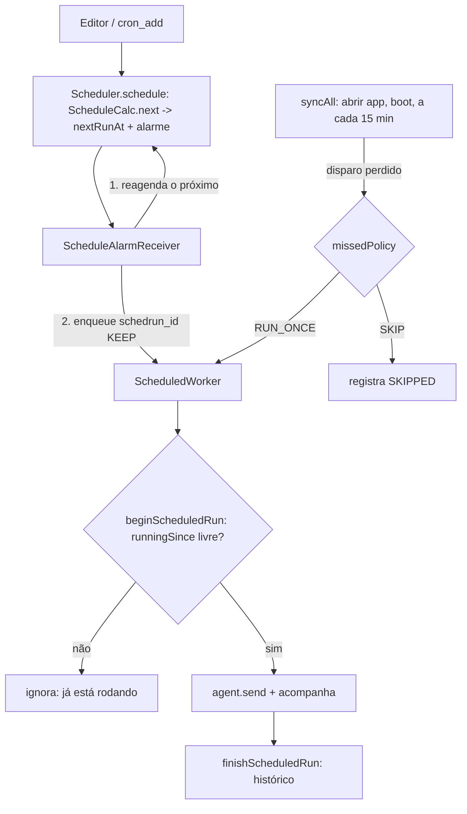
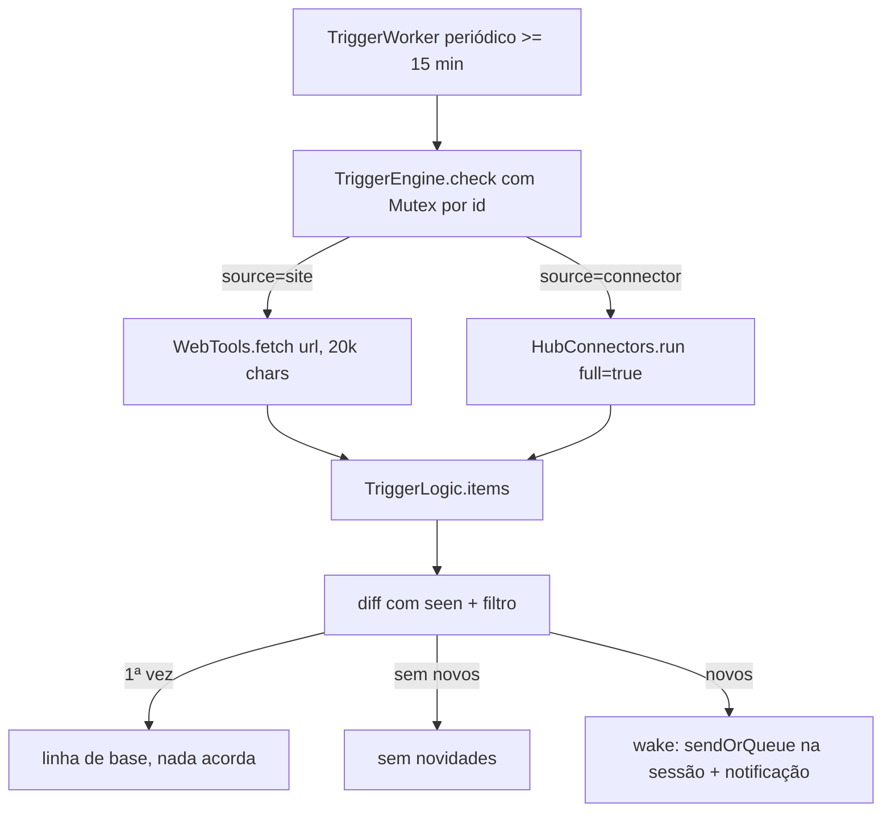

# Agendamento, gatilhos e autonomia

## Propósito

Executar trabalho do agente sem o usuário estar no chat: tarefas agendadas (prompts recorrentes), gatilhos que acordam uma sessão quando surge um evento novo, e agentes autônomos com heartbeat periódico. Os gatilhos de fluxos estão em [workflows.md](workflows.md).

## Arquivos principais

| Arquivo | Papel |
|---|---|
| `scheduler/Scheduler.kt` | `Scheduler` (alarme por agenda, `syncAll`, pausar/retomar, executar agora), `ScheduleAlarmReceiver`, `AutonomyWorker` (15 min), `BootReceiver`, `QuietRun`. |
| `scheduler/ScheduledWorker.kt` | Executa uma vez a tarefa e grava status/duração/erro no histórico. |
| `scheduler/ScheduleCalc.kt` | Lógica pura: próximo disparo, fuso, janela sem execução, disparos perdidos, dedup, histórico. |
| `scheduler/CronExpression.kt` | Parser/avaliador cron de 5 campos (puro). |
| `scheduler/ScheduleText.kt` | Rótulos pt-BR (regra, status, duração, data). |
| `ui/ScheduledScreens.kt` | Lista e editor de tarefas agendadas. |
| `scheduler/Heartbeat.kt` | Alarmes exatos por agente autônomo (`Heartbeat`) e `HeartbeatReceiver`. |
| `triggers/Triggers.kt` | `Trigger`, `TriggerStore` (SharedPreferences `fluwy_triggers`), `TriggerLogic` (puro), `TriggerEngine`, `TriggerWorker`. |
| `agent/AgentHeartbeat.kt` | `autonomyTick`, `startHeartbeatCycle`. |
| `agent/AgentRunner.kt` | `startAutonomy`, `triggerHeartbeatFromAlarm`. |
| `agent/AgentLoop.kt` | `canBeat`, `sleepAndWake`, `wakeUp`, `evaluateAllArmedRules`. |
| `agent/AgentToolDispatch.kt` | Ferramentas `cron_add/list/remove`, `set_schedule`, `sleep`, `trigger_create/list/delete`. |
| `ui/TriggersScreen.kt` | Tela de gatilhos. |

## Tarefas agendadas (Scheduler)

- **Regra**: `repeat` (`ONCE`, `HALF_HOUR`, `HOURLY`, `DAILY`, `WEEKLY`) ou `cron` opcional (5 campos, listas, intervalos, passos, nomes `jan`/`mon`, macros `@daily` etc.; dia-do-mês e dia-da-semana restritos casam com OU, como no cron clássico). Cron tem prioridade.
- **Fuso**: `timeZone` IANA (vazio = aparelho). Diário/semanal avançam em dias de calendário, mantendo a hora local no horário de verão.
- **Janela sem execução**: `quietStartHour`–`quietEndHour` (pode cruzar a meia-noite); disparos nela são adiados para o fim da janela.
- **Disparo**: um alarme `AlarmManager` exato por agenda (inexato sem permissão). O receiver arma o próximo antes de executar, então a corrente não quebra se a execução falhar.
- **Dedup**: trabalho único `schedrun_<id>` com `KEEP` e `runningSince` no `Store` (`beginScheduledRun` recusa se houver execução ativa; execução com mais de 3 h é considerada travada).
- **Perdidos**: `syncAll` compara `nextRunAt` com agora (tolerância 10 min). `RUN_ONCE` faz no máximo uma execução de recuperação (nunca rajada); `SKIP` só registra a execução pulada. Depois recalcula o próximo a partir de agora.
- **Histórico**: `runs` guarda as 20 últimas (`startedAt`, `durationMs`, `status` OK/QUIET/FAILED/SKIPPED, `error`, `sessionId`, `manual`).
- **Pausar/retomar**: `Scheduler.setEnabled` (o switch da lista); retomar recalcula a partir de agora.
- **Executar agora**: `Scheduler.runNow` (mesmo trabalho único: não roda em paralelo com uma execução em curso).
- `ScheduledWorker`: cria sessão "⏰ título" e envia o prompt `scheduled_run_header` (horário local + instrução do `QuietRun.MARKER`) seguido da tarefa.
- Notificação: falha → aviso de falha; resposta com o marcador → silenciosa "Execução sem novidades"; senão, se `settings.notifyOnDone`, "Tarefa agendada concluída".
- UI: lista ordenada por próxima execução com regra, estado (próxima/pausada/executando) e último resultado; editor com regra, cron com validação e prévia das 5 próximas execuções, fuso, janela, política de perdidos, Agent, executar agora, pausar e histórico (toque abre a conversa).
- Agente cria via `cron_add` (`once`, `half_hour`, `hourly`, `daily`, `weekly`); `cron_list` mostra regra, próximo disparo, último resultado e estado.
- Migração: agendas antigas (WorkManager periódico `sched_<id>`) são canceladas e passam ao alarme no primeiro `syncAll`; campos novos têm padrão, então dados existentes continuam válidos.

## Gatilhos (TriggerEngine)

- Fonte `connector`: ação de leitura de um conector do hub (`piece`, `action`, `input`, `connection`); itens = maior array do resultado; chave = campo id/messageId/uid ou hash SHA-256 (16 hex).
- Fonte `site`: cada trecho de texto da página (20 a 500 caracteres) vira um item, com chave que ignora números; só trechos novos acordam a sessão. Gatilhos antigos refazem a linha de base na primeira verificação.
- `seen` guarda os 500 ids mais recentes; `history` guarda 20 eventos.
- 3 falhas seguidas geram notificação de falha.
- `wake` envia à sessão existente (ou recria "⚡ nome") até 10 eventos (1500 chars cada) com a instrução e o lembrete de que ações externas exigem aprovação.

## Autonomia e heartbeat

- Agente autônomo: `AgentProfile.autonomous`, `homeSessionId`, `heartbeatMinutes`, janela `activeStartHour`–`activeEndHour`, `dailyTokenBudget`.
- `Heartbeat.schedule`: alarme exato (`setExactAndAllowWhileIdle`; inexato sem permissão) com `PendingIntent` por agente.
- `HeartbeatReceiver`: **reagenda primeiro** o próximo alarme, sobe `SandboxService` e chama `triggerHeartbeatFromAlarm` (sem bloquear o receiver).
- `canBeat` exige: autônomo, capacidade `BACKGROUND`, sessão-base ociosa, (opcionalmente) intervalo vencido, dentro da janela de horas e orçamento diário de tokens não esgotado (avisa uma vez por dia).
- `startAutonomy`: reagenda todos, inicia serviço em foreground se houver autônomos ou regras de trade armadas, e roda um laço a cada 5 s (`autonomyTick`) que também avalia regras de stop-loss/take-profit a cada ~20 s.
- `AutonomyWorker` (WorkManager, 15 min, `KEEP`) e `BootReceiver` religam tudo (inclusive alarmes de fluxos) após morte do processo ou reboot.
- `AppExit.exited` desliga todos os disparos quando o usuário saiu do app pelo menu.

## Dentro do loop

- `sleep`/`sleepAndWake`: o agente dorme e é acordado depois (ex.: sessões contínuas pausam 60 s ao atingir `maxSteps`).
- `set_schedule`: ajusta o heartbeat do agente.

## Persistência

`ScheduledTask` no `Store` (com `nextRunAt`, `runningSince` e `runs`); gatilhos em SharedPreferences; alarmes no AlarmManager (perdidos no reboot, por isso o `BootReceiver`); `lastBeatAt` no perfil do agente.

## Segurança

- Mensagens de gatilho lembram que ações externas precisam de aprovação; o `actionGate` do loop continua valendo.
- Orçamento diário de tokens limita custo da autonomia.

## Como estender

- Nova fonte de gatilho: adicione um ramo em `TriggerEngine.check` que devolva `List<JsonElement>`; a deduplicação é reaproveitada.
- Novo intervalo de tarefa: `Repeat`, `ScheduleCalc.rawNext` e `ScheduleText.repeat` (com teste em `ScheduleCalcTest`).

## Limitações conhecidas

- WorkManager impõe mínimo de 15 min para trabalhos periódicos (gatilhos forçam `coerceAtLeast(15)`); `HALF_HOUR` funciona, intervalos menores não.
- Gatilho de site dispara com qualquer mudança (anúncios, horários na página).
- Sem a permissão de alarme exato, o Android pode atrasar disparos alguns minutos; alarmes são religados no boot e a cada 15 min.
- O agente (`cron_add`) ainda não define cron, fuso ou janela; isso é feito no editor.
