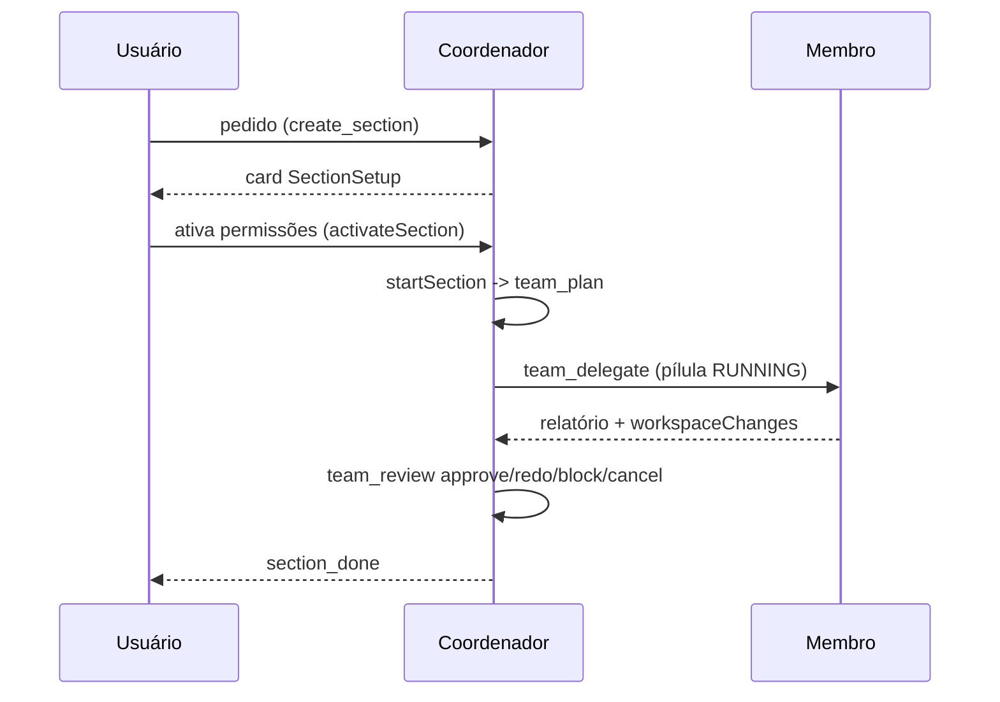

# Seções, times e delegação

## Propósito

Permitir que vários agentes trabalhem juntos. Há três modos:

1. **Seção**: um time persistente com coordenador e membros, cada um com seu chat, workspace e cofre compartilhados, guiado por um plano com revisão.
2. **`multi_agents`**: subtarefas paralelas efêmeras com dependências, executadas por workers isolados.
3. **Build squad (`build_team`)**: "exército" de agentes de desenvolvimento no mesmo projeto, com cursores ao vivo no browser.

## Arquivos principais

| Arquivo | Papel |
|---|---|
| `agent/AgentSections.kt` | `createSection`, `startSection`, `teamDelegate`, `memberSession`, `wipeRuntime/Workspace/Section`, `workspaceChanges`. |
| `agent/AgentTeamPlan.kt` | `teamPlan`, `teamReview`, `teamPeerMessage`, esperas cortáveis (`cuttableWait`, `waitUntil`), `autoContinue`. |
| `agent/AgentInteractions.kt` | `teamReassign` e interações de UI. |
| `agent/SectionPlanEngine.kt` | Máquina de estados pura do plano. |
| `agent/SectionSharedContext.kt` | Contexto compartilhado injetado no prompt de todos os agentes (até 5000 chars). |
| `agent/SectionWaitPolicy.kt`, `MemberSupervision.kt` | Política de espera e sinais de desvio/travamento. |
| `agent/AgentTeamTools.kt` | `runMultiAgents` (orquestração paralela com dependências). |
| `agent/AgentBuildTeam.kt`, `BuildSquad.kt` | `runBuildTeam`, personas, tarefas e paralelismo do squad. |
| `agent/AgentRunner.kt` | API pública: `activateSection`, `addAgentToSection`, `pauseSection`, `restartSection`, `archiveSection`, `MAX_PARALLEL_MEMBERS = 4`. |
| `data/Models.kt` | `Section` (coordinatorAgentId, agentIds, sessionId, configured, firstTask, originSessionId, plan). |
| `ui/SectionRows.kt`, `ui/ChatTeamCards.kt` | UI. |

## Ciclo de uma Seção

- `create_section` só existe fora de uma seção. A seção fica `configured=false` até o usuário ativar no card.
- `startSection` envia a primeira tarefa (ou a descrição) com instrução oculta para chamar `team_plan` e pôr o primeiro agente a trabalhar.
- O coordenador **não tem** terminal, browser, Android nem UI Connectors (`AgentToolSchemas` remove essas capacidades).

## Delegação (`team_delegate`)

1. Resolve o membro por nome exato ou parcial.
2. Recusa se ele já está trabalhando ou se há `MAX_PARALLEL_MEMBERS` (4) outros ativos.
3. Se a mesma tarefa (ou similar) foi entregue nas últimas 3 h, devolve o resultado anterior em vez de refazer.
4. Cria uma pílula `ChatItem.Step` no chat do coordenador e registra a `Delegation`.
5. Envia ao chat do membro a tarefa, a lista de arquivos do workspace compartilhado (até 40) e regras.
6. `wait=false` retorna `OK:` imediatamente; `wait=true` espera até `timeoutMinutes`.

Outras ferramentas: `team_status`, `team_message`, `team_peer_message` (entre membros), `team_stop`, `team_reassign`, `section_done`.

## Plano (`SectionPlanEngine`)

- Tarefa: `PENDING → RUNNING → REVIEW → DONE | PENDING (refazer, até 3 tentativas) | FAILED | BLOCKED | CANCELLED`.
- Seção (derivada): `IDLE, READY, RUNNING, WAITING_FOR_AGENT, VALIDATING, BLOCKED, COMPLETED, FAILED`. Só `COMPLETED` quando todas as tarefas estão DONE/CANCELLED.
- `validate`: até 30 tarefas, agentes existentes, ids únicos, sem ciclos (`cycle` por DFS).
- `ready` e `starved` (dependem de tarefa morta).
- `team_plan` é recusado com etapas em execução.

## Supervisão e autonomia

- `MemberSupervision`: checkpoint ao coordenador a cada 10 passos e cutucada após 5 rodadas silenciosas.
- Esperas do coordenador "pelo time" são encerradas quando o time fica ocioso; intervalos pedidos pelo usuário são respeitados.
- Seção autônoma (`confirmMode == "auto"` no coordenador): `autoContinue` manda seguir sozinho até `MAX_AUTO_NUDGES` (3) sem mudança no plano.

## Compartilhamento

- Workspace: todos os chats da seção apontam para o mesmo (ver [terminal.md](terminal.md)).
- Cofre: `SecretVault.scopeOf` usa `section_<id>`; seção herda o cofre do chat de origem.
- Contexto: `SectionSharedContext` (até 14 mensagens de 600 chars) com o que o usuário informou, respostas e entregas.

## multi_agents

`runMultiAgents(tasks_json, repo_path, max_workers=3, budget_tokens=6000)`: tarefas como strings ou `{id, task, depends_on}`; valida ids, autorreferência e ciclos; executa em ondas limitadas por `max_workers`, cada worker com workspace isolado e orçamento de tokens (`loop` com `tokenBudgetOverride`), e integra resultados (`WorkerMerge`: aplicados, removidos, conflitos).

## Build squad

`runBuildTeam`: `tasks_json` com `{id, role, task, target, depends_on, file}` (até 40), sem ids repetidos ou ciclos; orçamento por agente mínimo efetivo de 800 000 tokens (máx. 2 000 000); paralelismo 1–8 (padrão 6); `contract` opcional (3000 chars). `BuildSquad.assign` dá nome, mascote e cor; o browser mostra cursores (`pushSquadOverlay`), desativados em `liteMode`.

## Persistência

`Section` e sessões no `Store`; plano dentro de `Section.plan`; squads em `filesDir/squads/*.json`; `delegations`/`delivered` em memória (`recoverSections` na inicialização).

## Como estender

- Novo veredito ou estado: `SectionPlanEngine` (puro, com testes).
- Nova ferramenta de time: schema em `AgentToolSchemas` (bloco de seções) e `case` em `runTool`.

## Limitações conhecidas

- Delegações e entregas recentes ficam em memória; morte do processo perde a detecção de "já concluído".
- Similaridade de tarefa para evitar refação é heurística.
- No `runBuildTeam`, o limite inferior de `coerceIn(150_000, …)` nunca atua porque o valor já passou por `coerceAtLeast(800_000)`.
