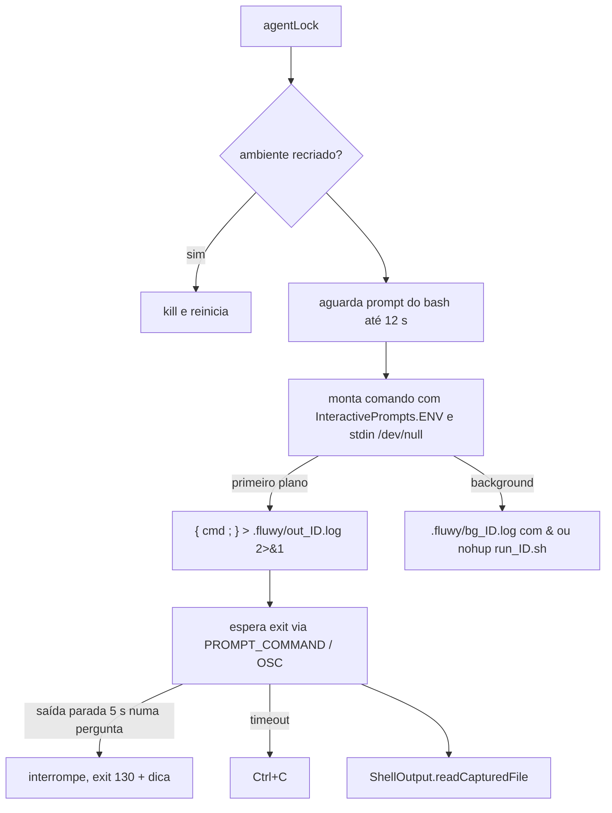

# Terminal e sandbox Linux

## Propósito

Fornece ao agente (e ao usuário, na tela Computador) um Linux Alpine local rodando via proot, com um terminal PTY por tarefa. A ferramenta `shell` executa comandos dentro desse mesmo terminal, visível em tempo real.

## Arquivos principais

| Arquivo | Papel |
|---|---|
| `sandbox/Sandbox.kt` | Instalação do rootfs Alpine (`filesDir/alpine`), scripts `init-sandbox.sh`/`init-alpine.sh`, workspaces por sessão, mapeamento de caminhos (`hostFile`, `guestPath`), proxy do escopo Terminal. |
| `sandbox/TerminalManager.kt` | `TerminalManager.Session`: PTY nativo (`libtermux.so`, `TerminalSession` do Termux) e `runAgentCommand`. |
| `sandbox/InteractivePrompts.kt` | Ambiente não interativo, detecção de perguntas e dicas. |
| `sandbox/SandboxService.kt` | Serviço em foreground (notificação "Terminal ativo"); com Live Server, segura Wi-Fi lock. |
| `sandbox/TerminalRecoveryPolicy.kt` | Recuperação do cwd e do transcript (até 60 000 chars, só SGR) após morte do processo. |
| `agent/ShellOutput.kt` | Limpeza e corte da saída (head/tail). |
| `agent/ShellCommandPolicy.kt` | Detecta servidores de longa duração e buscas no sistema inteiro. |
| `agent/BrowserRedirect.kt` | Bloqueia instalação de navegadores/drivers no terminal. |
| `agent/AgentWorkspaceTools.kt` | Implementação da ferramenta `shell`. |

## Workspaces

- Cada chat tem `workspaceFor(sessionId)` visto dentro do sandbox como `/root/workspace`.
- Chats da mesma Seção compartilham o workspace.
- Sessões de UI Connector (prefixo `__uic__`) têm raiz própria em `connectors/<id>`; a raiz de conectores é montada em `/root/connectors` em toda sessão.
- A base Alpine não recebe escritas de sessões.

## Fluxo da ferramenta `shell`

1. `SecretVault.resolve` substitui `{{secret:…}}` no comando.
2. Guardrails determinísticos (retornam `GUARDRAIL:` sem executar): instalar navegador/driver, busca no sistema inteiro (`find /`, `grep -r … /`, `/vendor`, `/sdcard`…), script direto inexistente (`bash /x.sh`), `cd` para diretório inexistente.
3. Se `ShellCommandPolicy.isLongRunningServer` (http.server, `npm run dev`, vite, uvicorn…) e não pediu `background`, força segundo plano e avisa.
4. `terminals.get(sessionId, cwd).runAgentCommand(command, timeout ?: 180, background)`.
5. Resultado formatado por `ShellOutput.formatExecutionResult` com `[exit N]` e `[timeout]`.

## runAgentCommand

- Comandos "simples" (uma linha, ≤300 chars, aspas balanceadas, sem heredoc) são digitados direto; os demais vão para `.fluwy/run_ID.sh`.
- Envia só `\u0015` + comando + `\r` (um `\n` extra disparava o marcador de fim antes do comando).
- O exit code vem exclusivamente do `PROMPT_COMMAND`.
- Cancelamento do agente envia Ctrl+C ao PTY.
- Sem arquivo de captura e sem exit: o terminal estava ocupado por outro processo em primeiro plano; o comando não rodou.
- Captura sumida: terminal preso a workspace apagado; é reiniciado e o agente é avisado para conferir efeitos.

## Captura de saída

- `ShellOutput.compact`: barras de progresso com `\r` viram o último estado; linhas repetidas de mesmo "formato" são resumidas.
- `INLINE_LIMIT = 12 000` caracteres: acima disso, volta início (2 000) + fim, e a saída completa é copiada para `.fluwy/out/cmd_ID.log` (mantidos os 20 mais recentes), citada pelo caminho para `grep -n`/`file_read`.
- Saída vazia recebe mensagem explícita (ex.: `exit 1` em grep/find = "nada encontrado").

## Prompts interativos

- `InteractivePrompts.ENV` exporta `CI=1`, `npm_config_yes`, `DEBIAN_FRONTEND=noninteractive`, `PIP_NO_INPUT`, `GIT_TERMINAL_PROMPT=0` etc.
- `waitingPrompt` reconhece `(y/n)`, `password:`, `Do you want to`, setas de menu (`❯`, `◆`)…
- `looksCancelled` reconhece "not a tty", "EOF when reading"…
- `hint` devolve dicas por ferramenta (npx `--yes`, `apt-get -y`, `pip --no-input`, sem `sudo`).

## Servidores em segundo plano

Retornam imediatamente "Iniciado em segundo plano. Log: …/bg_ID.log" com as primeiras linhas após 1,5 s. O script `run_ID.sh` não é apagado em background (nohup ainda o lê).

## Segurança

- Tudo roda sob proot no espaço do app; sem root real.
- Downloads do bootstrap usam o proxy do escopo Terminal.
- Saída passa por `SecretVault.redact` antes do modelo.
- Transcript recuperado só aceita sequências SGR (sem OSC/cursor), evitando injeção de controle.

## Como estender

- Novas regras de comando: `ShellCommandPolicy` (puro, testável).
- Novas dicas interativas: `InteractivePrompts.hint`.

## Limitações conhecidas

- Um comando por vez por sessão (`agentLock`).
- PTY não sobrevive à morte do processo Android; apenas cwd/transcript são recuperados.
- Detecção de servidor e de pergunta é por regex.
