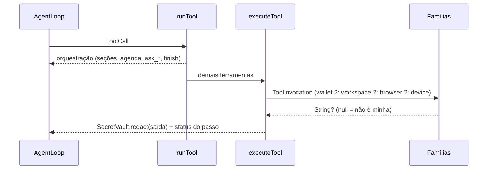

# Ferramentas do agente

## Propósito

Define como as ferramentas são descritas ao LLM (schemas JSON), como são executadas por família e quais convenções de mensagem o loop interpreta.

## Arquivos principais

| Arquivo | Papel |
|---|---|
| `llm/OpenRouter.kt` | Helpers `tool(name, description, props, required)`, `str`, `int`, `bool`, `strArray` (formato function-calling). |
| `agent/AgentToolSchemas.kt` | `AgentRunner.tools(agent, allowMultiAgent, builder, connectorEditId, sectionId, scriptBuilder, webApiBuilder)`. |
| `agent/AgentToolDispatch.kt` | `runTool` e `executeTool`. |
| `agent/AgentWalletTools.kt` | `walletTools`: `wallet_*`, `market_*`, `trade_*`. |
| `agent/AgentWorkspaceTools.kt` | `workspaceTools`: `shell`, `file_*`, `page_*`, `web_search`, `web_fetch`. |
| `agent/AgentBrowserTools.kt` | `browserTools`: `browser_*`, abas, `conector_*`, `pix_qr`, `notify`, `show_cards`. |
| `agent/AgentDeviceTools.kt` | `deviceTools`: `device_*`, acessibilidade, `send_file`. |
| `agent/ToolAliases.kt` | Resolve nomes alternativos para nomes expostos. |
| `app/src/test/.../agent/ToolSchemaQualityTest.kt` | Testa a qualidade dos schemas. |

## Convenções de schema

- Nome em `snake_case` (`[a-z][a-z0-9_]*`).
- Descrição explica **o que faz e quando usar** (mínimo de 40 caracteres, verificado em teste).
- Todo parâmetro tem descrição não vazia (`str("")` é proibido).
- Ferramentas condicionais: `allowMultiAgent` (ex.: `ask_user`, `ask_question`, `ask_secure`), `webApiBuilder` (`webapi_probe/test/save`), `scriptBuilder` (`userscript_*`), seção (`create_section` só fora de seção).
- Ferramentas de dispositivo só aparecem se a capacidade está no perfil **e** concedida (`DeviceCapPolicy.availableTools`).
- Segredos: o modelo usa `{{secret:<name>}}`; `SecretVault.resolve` troca na execução.

## Fluxo de execução

Cada família é `suspend fun AgentRunner.xxxTools(inv: ToolInvocation): String?` e devolve `null` quando o nome não lhe pertence.

## Convenções de mensagem de erro

| Prefixo | Significado | Tratamento |
|---|---|---|
| `ERRO:` / `ERROR:` | Falha da ferramenta | Passo marcado ERROR, vai ao `ErrorLog`, conta no `RepeatedToolFailureGuard`. |
| `TIMEOUT:` / `PARTIAL:` | Execução incompleta | Tratado como erro. |
| `[exit N]` (N≠0) | Comando do shell falhou | Erro, exceto "sondagens benignas" (`exit 1/7/22`, saída curta sem palavras de erro). |
| `GUARDRAIL:` | Política bloqueou (ex.: varrer `/`, script inexistente, instalar navegador) | Marcador de erro na 1ª linha → log. |
| `RECUSADO:` | Ferramenta não exposta ou ação recusada | Nenhuma ação executada. |
| `NÃO EXECUTADO:` | Aguardando aprovação de ação anterior | Nada executado. |

Marcadores na 1ª linha (`MARKET_ERROR`, `WALLET_RPC_ERROR`, `GUARDRAIL`, `not found`, `Recusado`, `Acesso negado`…) também são registrados, exceto em ferramentas de conteúdo (`web_*`, `file_read`, `notes_read`, `memory_search`, `knowledge_search`).

## Como adicionar uma ferramenta

1. Declare em `AgentToolSchemas.kt` com `tool("nome", "descrição com quando usar", buildJsonObject { put("arg", str("descrição")) }, listOf("arg"))`.
2. Inclua o nome no grupo adequado de `ToolContextPlanner.GROUPS` (senão ela pode não ser exposta).
3. Implemente o `when` na família correta (ou em `runTool` se for orquestração), lendo args com `s/i/b/sl`.
4. Use os prefixos de erro acima e sempre `SecretVault.resolve` para textos digitados.
5. Se for sensível, adicione regra em `actionGate`/`ActionGate.kt`.
6. Opcional: rótulo em `ToolActivityLabels.kt`.
7. Rode `ToolSchemaQualityTest`.

## ToolSchemaQualityTest

Lê `AgentToolSchemas.kt` como texto e aplica regex: `namesAreSnakeCase` (exige >20 ferramentas), `descriptionsExplainWhenToUse` (≥40 chars), `everyParameterHasADescription`.

## Persistência

Resultados: passo de UI (até 4000 chars), `ToolExecutionManager` (12 000 chars), `ActivityLog`, `.fluwy/out` para saídas longas.

## Limitações conhecidas

- O teste só enxerga ferramentas declaradas literalmente via `tool("…", "…")` em `AgentToolSchemas.kt`; schemas montados com concatenação ou em outros arquivos (ex.: conectores/MCP) escapam.
- A classificação de erro por prefixo de texto depende das ferramentas seguirem a convenção.
