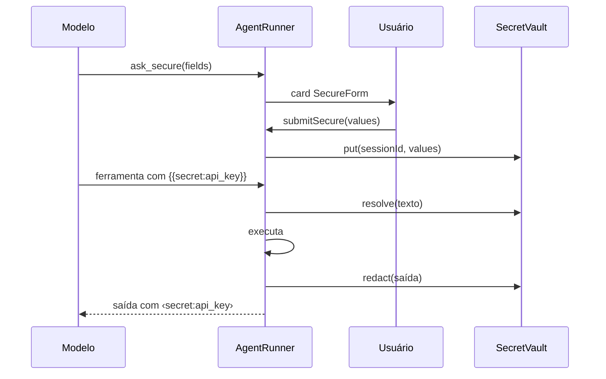

# Cofres e segredos

## Propósito

Garantir que dados sensíveis (API keys, senhas, chaves Pix, cartões, credenciais de conectores) fiquem no aparelho e nunca cheguem ao LLM, ao histórico ou aos logs. Há quatro mecanismos complementares.

## Arquivos principais

| Arquivo | Papel |
|---|---|
| `agent/SecretVault.kt` | Cofre em memória por tarefa para valores do formulário `ask_secure`; marcadores `{{secret:nome}}`, `resolve` e `redact`. |
| `uiconnector/CredentialVault.kt` | Credenciais de UI Connectors cifradas (AES-256-GCM, chave no Android Keystore) em SharedPreferences. |
| `vault/CardVault.kt` | Cartões cifrados, isolados da IA (sem CVV). `CardRules`: Luhn, validade, CPF, bandeira. |
| `vault/Pix.kt` | `PixVault` (chaves Pix cifradas) e `PixRules` (validação, BR Code com CRC16, parse). |
| `vault/VaultTools.kt` | Única ponte agente ↔ Cofre: `cofre_listar` e `pix_qr`. |
| `diag/ErrorLog.kt` | `redact` por padrões antes de gravar. |
| `diag/ConnectorDebugLog.kt` | Sanitização dos logs de depuração de conectores (só metadados). |
| `ui/VaultScreen.kt` | Tela do Cofre. |

Também existem `wallet/WalletSecretVault.kt` (carteira Solana, ver `docs/solana-wallet-security.md`) e `backup/SecureBox.kt` (backup cifrado), fora do escopo deste documento.

## SecretVault (segredos de tarefa)

- Nomes válidos: `^[a-z][a-z0-9_]{0,31}$`; valores vazios ignorados.
- Escopo: `scopeOf` (definido em `FluwyApp`) faz chats da mesma Seção compartilharem um cofre (`section_<id>`). Seções criadas a partir de um chat herdam um `snapshot` do cofre de origem.
- `redact` substitui, do valor mais longo ao mais curto, ocorrências cruas, URL-encoded e Base64 (com e sem `=`) por `‹secret:nome›`; valores com menos de 3 chars não são mascarados, Base64 só para ≥6.
- Valores só em memória (`ConcurrentHashMap`): somem ao fechar o app.
- Usado em `shell`, `browser_type`, `browser_js`, `browser_new_tab`, `device_notification_reply`… e em toda saída via `executeTool`.

## CredentialVault (conectores)

- Chave AES-256 GCM gerada no `AndroidKeyStore` (não exportável); blob = IV + ciphertext, Base64, chave `cred_<connectorId>`.
- `load` devolve `null` se ilegível (ex.: chave invalidada).
- `migrateKey(oldAlias)`: recifra com a chave atual e apaga a antiga; entradas ilegíveis permanecem.
- Lidas apenas pelo conector ao (re)logar.

## Cofre (Pix e cartões)

- `CardVault` e `PixVault` usam AES-256-GCM com o alias de Keystore `fluwy_cofre_cards_v1` (compartilhado), entradas `cards` e `pix`.
- Cartões: somente a tela do Cofre lê; exibição sempre mascarada; CVV nunca guardado.
- `VaultTools.describe` mostra à IA apenas ids, apelidos, tipo e bandeira.
- `pix_qr`: escolhe a chave (id, apelido ou única), valida valor (`parseCents`), monta e **confere** o BR Code (`checkedPayload`) e cria `ChatItem.PixQr`; o app desenha o QR. A IA recebe só uma frase de confirmação.

## Redação no ErrorLog

`ErrorLog.redact` mascara (mantendo o prefixo e trocando o valor por `•••`):

- `Bearer <token>` (≥12 chars);
- prefixos `sk-`, `pk-`, `rk-`, `ghp_`, `gho_`, `xoxa/b/p-` seguidos de ≥12 chars;
- query strings `key=`, `api_key=`, `apikey=`, `token=`, `access_token=`, `secret=`, `password=`;
- JSON `"api_key"|"token"|"secret"|"password"|"authorization": "..."`.

Saídas de ferramentas já chegam ao log após `SecretVault.redact`.

## Segurança — resumo

| Dado | Onde fica | Chega à IA? |
|---|---|---|
| Valores `ask_secure` | Memória, por tarefa/seção | Não (só nomes) |
| Credenciais de conector | SharedPreferences cifradas | Não |
| Chave Pix / código copia-e-cola | Cifrado / gerado na UI | Não |
| Cartões | Cifrado | Não (só bandeira) |

## Como estender

- Nova ferramenta que recebe texto do modelo: chame `SecretVault.resolve(sessionId, texto)` antes de usar.
- Novo padrão de segredo para logs: adicione regex a `secretPatterns` com o prefixo no grupo 1.
- Novo dado de cofre: classe cifrada como `PixVault`, exposta à IA somente por funções do tipo `VaultTools`.

## Limitações conhecidas

- `redact` só conhece valores do `SecretVault`; segredos que não vieram de `ask_secure` (ex.: headers capturados por `browser_network`) só são mascarados pelos padrões genéricos do `ErrorLog`, e não na resposta ao modelo.
- Segredos curtos (<3 chars) não são mascarados.
- `CardVault` e `PixVault` compartilham o mesmo alias de chave; invalidar a chave afeta ambos.
