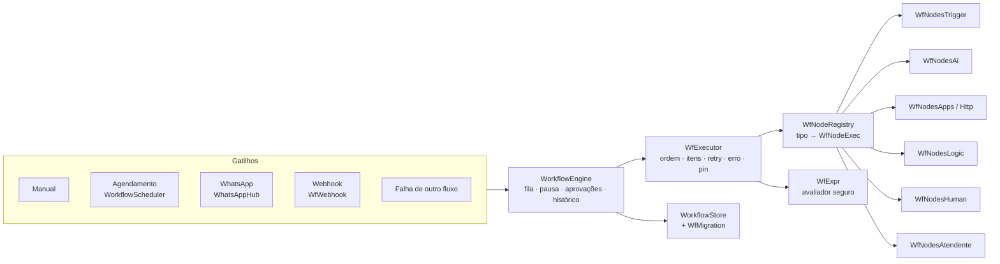
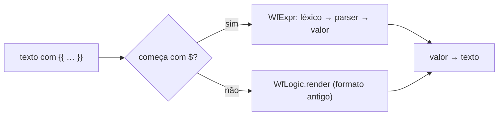
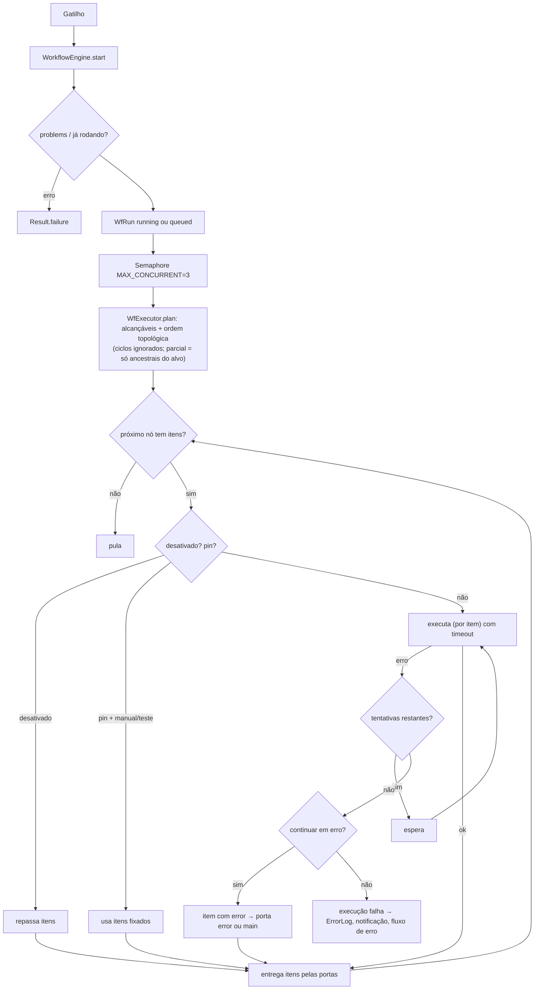

# Fluxos (workflows)

## Propósito

Automação visual com a arquitetura do n8n: nós ligados por portas, dados que circulam como **lista de itens JSON**, expressões `{{ $json… }}`, execução ordenada com retentativa, "continuar em caso de erro", tempo máximo, dados fixados (pin), execução parcial e fluxo de erro. Disparo manual, por horário, por webhook (ponte GitHub), por mensagem no WhatsApp ou pela falha de outro fluxo.

## Arquitetura

| Arquivo | Papel |
|---|---|
| `workflow/WorkflowModels.kt` | `Workflow` (`version`, `errorWorkflowId`), `WfNode` (+ `settings`), `WfNodeSettings`, `WfEdge` (porta), `WfRun` (`until`), `WfStep` (entrada/saída, nº de itens, tentativas, pin), `WfCatalog` (schema dos tipos e presets). |
| `workflow/WfItems.kt` | `WfItem(json, raw)` e conversões texto ⇄ itens (histórico, pin). |
| `workflow/WfExpr.kt` | Avaliador de expressões (léxico + parser próprios, sem eval) e `WfExprCtx`. |
| `workflow/WfExprCheck.kt` / `WfExprConvert.kt` | Validação estática das expressões; conversão do formato antigo para o novo (usada nos modelos). |
| `workflow/WfExecutor.kt` | Executor puro (testável na JVM): plano topológico, entrega de itens por porta, políticas por nó. |
| `workflow/WfNodeApi.kt` | `WfNodeExec` (tipo executável), `WfNodeCtx`, `WfCall`, `WfNodeOutput`, `WfItemNode`, `NodeResult`. |
| `workflow/WfNodeRegistry.kt` | Registro tipo → executor. |
| `workflow/WfNodes*.kt` | Uma família de nós por arquivo (gatilhos, IA, apps, HTTP, lógica, humano/saída, atendente). |
| `workflow/WorkflowEngine.kt` | Orquestração: `start` (inclusive parcial), fila (`MAX_CONCURRENT=3`), pausa, cancelamento, aprovação/revisão, `testNode`, `publishTested`, fluxo de erro. |
| `workflow/WorkflowScheduler.kt` | Agendamento (alarme exato + reserva no WorkManager), `WfScheduleState`, receiver e worker. |
| `workflow/WorkflowStore.kt` | Persistência atômica; migra ao carregar e ao salvar. |
| `workflow/WfMigration.kt` | Migração de formato (v1 → v2). |
| `ui/WorkflowEditorScreen.kt` | Canvas, portas, menu (fluxo de erro, autonomia…). |
| `ui/WorkflowNodes.kt` | Paleta, card do nó (status, portas sim/não/erro, pin, desativado) e editor do nó com abas **Entrada · Parâmetros · Saída · Configurações**. |
| `ui/WorkflowNodeIo.kt` | Painéis de itens (entrada/saída), "Executar até aqui", fixar saída, configurações do nó. |
| `ui/WorkflowNodeConfig.kt` | Conector, teste do nó, lista de execuções com detalhe por nó. |
| `ui/WorkflowTemplates.kt` | 21 modelos (convertidos para expressões n8n por `flow()`). |

## Modelo de dados por itens

- Cada nó recebe uma lista de itens `[{json: {...}}]` e produz itens por **porta de saída**: `main`, `true`/`false` (Condição, Decisão por IA, Se for novo, Revisar, Aprovação) e `error` (quando "continuar em caso de erro" está ligado).
- Nós **por item** (a maioria) rodam uma vez por item; `delay` e `aggregate` rodam uma vez com todos.
- A saída de texto de um nó vira um item: objeto JSON → o item; texto → `{text: "..."}`; array → `{items: [...]}`. O texto original é preservado para o formato antigo (`{{prev}}`).
- `split_out` (Separar em itens) transforma uma lista em vários itens; `aggregate` (Juntar itens) junta tudo em `{items: [...], count}`.
- Ligação `main` saindo de um nó com ramos recebe todos os itens (compatível com o comportamento antigo).

## Expressões

- Novas: `{{ $json.campo }}`, `{{ $json["a b"][0] }}`, `{{ $node["Nome"].json.x }}`, `{{ $('Nome').item.json.x }}`, `{{ $input.first().json }}`, `{{ $trigger.json.payload.text }}`, `{{ $now.toFormat('dd/MM/yyyy') }}`, `{{ $now.plus(1, 'days') }}`, `{{ $today }}`, `{{ $execution.id }}`, `{{ $execution.mode }}`, `{{ $workflow.name }}`, `{{ $itemIndex }}`, `{{ $prevNode.name }}`.
- Operadores: `+` (soma/concatena), `-`, `||` e `??` (padrão). Métodos permitidos (lista fechada): texto (`toUpperCase`, `toLowerCase`, `trim`, `includes`, `split`, `replace`, `slice`, `startsWith`, `endsWith`, `extractEmail`, `toNumber`, `toFixed`, `round`), listas (`join`, `first`, `last`, `includes`, `slice`, `reverse`, `pluck`, `length`), objetos (`keys`, `values`, `hasField`), datas (`toFormat`, `toISO`, `toMillis`, `plus`, `minus`, `startOf`).
- Segurança: não há `eval`; qualquer caractere/nome fora da gramática é erro e o token vira vazio. Preenchimento numa única passada (dados com `{{…}}` nunca são reinterpretados).
- Antigas continuam valendo: `{{prev}}`, `{{prev.a.0}}`, ``, `{{<id>.campo}}`, ``, `{{trigger.time}}`, `{{trigger.type}}`, `{{workflow.name}}`, `{{trigger.payload.x}}` (atalho para a saída do gatilho) e filtros (`| default:x`, `| text`, `| email`…).
- Validação (`WfLogic.problems` + `WfExprCheck`): sintaxe e nós referenciados por nome antes de executar. Campos de IA/agente/aviso/e-mail barram referência vazia na execução.

## Execução

- Ordem: topológica a partir do gatilho (empate pela posição no canvas); um nó com várias entradas espera todas e recebe os itens concatenados. Cada nó roda no máximo uma vez.
- Configurações por nó (`WfNodeSettings`): `retries` (0–10), `retryWaitMs`, `continueOnFail`, `timeoutSec` (por item; 0 = sem limite), `disabled`, `pinData`.
- Histórico (`WfStep`): entrada e saída (texto dos itens, até 6 000/12 000 chars), nº de itens de entrada/saída, tentativas, pin, erro ignorado. Teto de 60 min por execução.
- **Execução parcial**: `start(id, until = nodeId)` roda em modo teste só o alvo e seus ancestrais ("Executar até aqui" na aba Saída). Não marca o fluxo como testado.
- **Testar nó**: `testNode` roda só o nó com os itens que ele recebeu na última execução.
- **Fluxo de erro**: `Workflow.errorWorkflowId` (menu ⋮ › Fluxo de erro). Execução real que falha dispara o fluxo escolhido com `trigger="error"` e payload `{workflow:{id,name}, execution:{id,error,lastNode,mode}}`, lido pelo gatilho `trigger_error`.
- `pause` atua entre nós; `cancel` cancela o job. Status: `running`, `queued`, `paused`, `waiting`, `ok`, `error`, `cancelled`.

## Tipos de nó (`WfCatalog.TYPES` / `WfNodeRegistry`)

| Família (arquivo) | Tipos |
|---|---|
| Gatilhos (`WfNodesTrigger`) | `trigger_manual`, `trigger_schedule`, `trigger_webhook`, `trigger_whatsapp`, `trigger_error` |
| IA (`WfNodesAi`, `WfNodesAtendente`) | `ai`, `ai_decide`, `agent`, `atendente` |
| Apps (`WfNodesApps`, `WfNodesHttp`) | `connector`, `webapi`, `http`, `shell`, `mcp` (oculto, legado) |
| Lógica (`WfNodesLogic`) | `set`, `if`, `if_new`, `split_out`, `aggregate`, `delay` |
| Humano/saída (`WfNodesHuman`) | `approval`, `review`, `notify` |

## Gatilhos

- **Agendamento**: `WorkflowScheduler.scheduleNext` usa alarme exato (ou inexato sem permissão) → `WorkflowAlarmReceiver` → `fireNow` (WorkManager), mais reserva 90 s depois; `WfLogic.shouldFire` descarta duplicatas. Religado no boot e ao abrir o app.
- **Webhook**: `WfWebhook.poll` lê comentários de uma issue do GitHub a cada minuto (1ª linha = `secret`, mín. 12 chars).
- **WhatsApp**: `WhatsAppHub.fireFlows` → `start(trigger="whatsapp", payload)` para `trigger_whatsapp` cujo filtro casa.
- **Manual**: botão Executar. **Erro**: ver fluxo de erro.

## Compatibilidade e migração

- `WfMigration.CURRENT = 2`. Arquivos sem `version` chegam como 1 e são migrados ao carregar/salvar: `http.onError=continue` → `settings.continueOnFail` (também aplicado em v2, pois o agente ainda pode mandar `onError`); portas desconhecidas viram `main`. Expressões antigas não são reescritas (continuam funcionando).
- `WfLogic.signature` inclui configurações não padrão (exceto pin): mudar retentativa/erro exige novo teste antes de publicar.
- Modelos novos são gerados já no formato v2, com expressões n8n (`WfExprConvert`).

## Testes e publicação

- Execução `trigger="test"`: leituras reais, envios externos simulados (`simulated`), Web APIs com `__dry_run`, agente instruído a não enviar.
- `publishTested`: se a assinatura difere de `testedSig`, roda o teste completo (até 6 min) e só ativa se passar.
- Testes JVM: `WfExprTest` (avaliador), `WfExecutorTest` (itens, ramos, retry, continuar em erro, timeout, pin, parcial, ciclos), `WfMigrationTest` (formato antigo, conversão de expressões), além de `WfLogicTest`, `WfScenarioTest`, `WfScheduleTest`.

## Ferramenta do agente

`workflow_manage(action, …)`: `list`, `get`, `create`, `update`, `validate`, `test`, `status`, `publish`, `run`, `enable`, `disable`, `delete`.

## Segurança

- Avaliador de expressões sem eval nem reflexão; só leitura dos dados da execução.
- Webhook exige segredo; envios externos nunca acontecem em teste/execução parcial.
- `http` e `shell` executam o que o usuário configurou (sem sandbox além do Linux do app).

## Como estender

1. Descreva o tipo em `WfCatalog.TYPES` (campos `WfField`, portas).
2. Implemente no arquivo da família: `internal suspend fun nodeX(c: WfCall): NodeResult` (um item por item) ou uma subclasse de `WfNodeExec` (controle total dos itens).
3. Registre em `WfNodeRegistry.all`.
4. Se envia algo para fora, trate `c.run.trigger == "test"` com `simulated`.
5. Opcional: preset na paleta e modelo em `WorkflowTemplates.kt`.

## Limitações conhecidas

- Um fluxo não roda em paralelo consigo mesmo (WhatsApp guarda pendentes).
- Itens pareados são por índice (sem `pairedItem` completo do n8n): `$node["X"].json` usa o item de mesmo índice, ou o primeiro.
- Execução parcial reexecuta os nós anteriores (em modo teste) em vez de reaproveitar a última execução; use pin para evitar.
- Webhook depende da API do GitHub (~1 min de latência).
