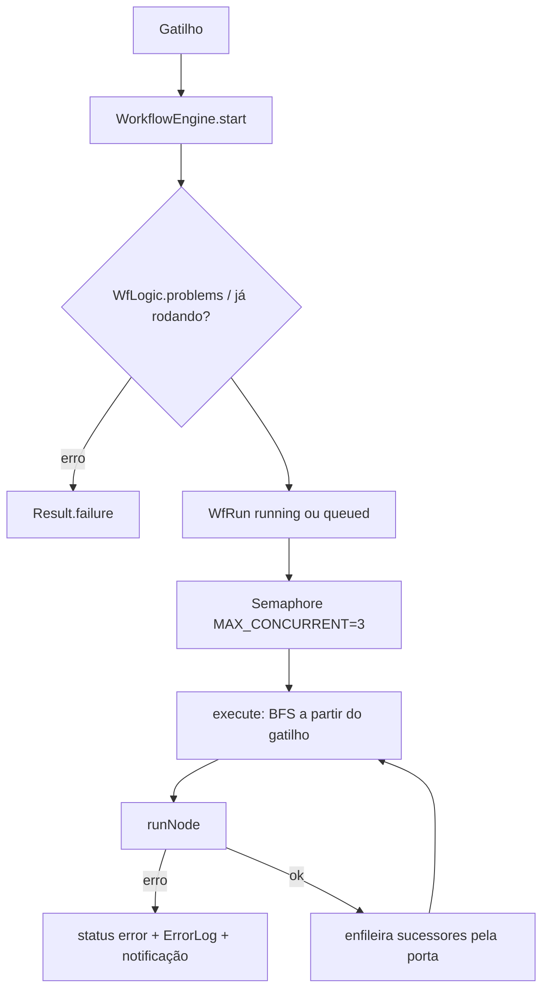

# Fluxos (workflows)

## Propósito

Automação visual no estilo n8n: nós ligados por arestas, disparados manualmente, por horário, por webhook ou por mensagem no WhatsApp. Cada nó recebe a saída do anterior e pode referenciar qualquer nó já executado.

## Arquivos principais

| Arquivo | Papel |
|---|---|
| `workflow/WorkflowModels.kt` | `Workflow`, `WfNode`, `WfEdge` (porta `main`, `true`/`false`), `WfRun`, `WfStep`, `WfCatalog` (tipos e presets), `WfField`. |
| `workflow/WorkflowEngine.kt` | `WorkflowEngine` (start, execute, runNode, aprovação/revisão, pause/resume, testNode, publishTested), `WorkflowScheduler`, `WfScheduleState`, `WorkflowAlarmReceiver`, `WorkflowWorker`. |
| `workflow/WorkflowStore.kt` | Persistência em arquivos próprios (gravação atômica), histórico de execuções por fluxo, memória "já visto" de `if_new`. |
| `workflow/WfLogic.kt` | Regras puras: `problems` (validação), `render` (templates), `condition`, `nextFire`, `shouldFire`, `signature`, `layout`, parser de frequência em linguagem natural. |
| `workflow/WfChannels.kt` | `WfWebhook`: ponte via comentários de issue do GitHub. |
| `workflow/WfConnectors.kt`, `WfEmail.kt`, `WfFeed.kt`, `WfFormat.kt`, `WfQuality.kt`, `WfRetry.kt`, `WfView.kt` | Integrações, formatação, validação de envios, retentativas, renderização. |
| `agent/AgentWorkflowTool.kt` | Ferramenta `workflow_manage` do agente. |
| `ui/Workflow*.kt` | Lista, editor (canvas), configuração de nós, templates (`WorkflowTemplates.kt`, 21 modelos). |

## Tipos de nó (`WfCatalog.TYPES`)

| Categoria | Tipos |
|---|---|
| Gatilhos | `trigger_manual`, `trigger_schedule` (interval/daily/weekly), `trigger_webhook`, `trigger_whatsapp` |
| IA | `ai` (chamada rápida sem ferramentas), `ai_decide`, `agent` (agente completo com ferramentas, cria um chat), `atendente` (atendente de WhatsApp) |
| Apps | `connector`, `webapi`, `http`, `shell`, `mcp` (oculto, legado) |
| Lógica | `set`, `if`, `if_new`, `review`, `delay` (0–3600 s), `approval` |
| Saída | `notify` (e outros presets da paleta) |

## Templates de texto

`WfLogic.render` substitui `{{prev}}`, `{{trigger.time}}`, `{{trigger.type}}`, `{{workflow.name}}`, `{{trigger.payload.<campo>}}`, ``, `{{<id>.campo.sub}}` e ``. Saídas JSON são navegáveis; referência desconhecida vira vazio. Filtros (ex.: `default:`) via `applyFilters`. Em campos de IA/agente/aviso/e-mail (`EMPTY_CHECK`), referência vazia é erro antes de executar.

## Fluxo de execução

- Cada nó roda no máximo uma vez por execução; limite de 200 passos (protege ciclos) e 60 min por execução.
- Saída de cada passo guardada até 20 000 chars.
- `pause` atua entre nós; `cancel` cancela o job.
- Status: `running`, `queued`, `paused`, `waiting` (aprovação), `ok`, `error`, `cancelled`.
- `approval` espera `approve(runId, nodeId, ok)`; `review` abre página com rascunho editável (`decideReview`); com `autonomous=true` revisões seguem sozinhas.
- Inicia o `SandboxService` em foreground durante a execução.

## Gatilhos

- **Agendamento**: `WorkflowScheduler.scheduleNext` usa alarme exato (`setExactAndAllowWhileIdle`, ou inexato sem permissão) → `WorkflowAlarmReceiver` → `fireNow` (WorkManager), mais uma reserva no WorkManager 90 s depois. `WfLogic.shouldFire` descarta duplicatas (janela de 30 s). Último/próximo disparo em SharedPreferences `wf_schedule`. Próximo é agendado antes de rodar. Religado no boot e ao abrir o app (`syncAll`).
- **Webhook**: não há servidor público; `WfWebhook.poll` lê, a cada minuto, comentários de uma issue do GitHub (`repo`, `issue`), aceitando só os cuja 1ª linha é o `secret` (mín. 12 chars), com ETag e último id processado. Cada comentário novo gera uma execução, em ordem.
- **WhatsApp**: `WhatsAppHub.fireFlows` chama `start(trigger="whatsapp", payload)` para nós `trigger_whatsapp` cujo filtro casa (conversa, privado/grupo, palavras com `|`, `from_me`). Ver [api-hub.md](api-hub.md).
- **Manual**: botão Executar na lista/editor.

## Testes e publicação

- `testNode`: roda um nó isolado usando as saídas da última execução.
- Execução `trigger="test"`: leituras reais, envios externos simulados (`simulated` devolve `would_send`), Web APIs com `__dry_run`, agente instruído a não enviar nada.
- `publishTested`: se a `signature` atual difere de `testedSig`, roda o teste completo (até 6 min); só ativa (`enabled=true`) se passar e o fluxo não mudou durante o teste.

## Ferramenta do agente

`workflow_manage(action, …)`: `list`, `get`, `create`, `update`, `validate`, `test`, `status`, `publish`, `run`, `enable`, `disable`, `delete`. Aceita id por prefixo único ou nome.

## Persistência

`WorkflowStore` (arquivos em `filesDir`), histórico por fluxo, SharedPreferences `wf_schedule` e `wf_webhook`. Payloads de webhook ficam só em memória durante a execução.

## Segurança

- Webhook exige segredo na 1ª linha do comentário.
- Envios externos nunca acontecem em modo teste.
- `http` e `shell` executam o que o usuário configurou; não há sandbox adicional além do Linux do app.

## Como estender

1. Adicione `WfNodeType` em `WfCatalog.TYPES` (campos `WfField`, portas).
2. Implemente o `case` em `runNode` (`WorkflowEngine.kt`).
3. Se envia algo para fora, trate `run.trigger == "test"` com `simulated`.
4. Opcional: preset na paleta e template em `WorkflowTemplates.kt`.

## Limitações conhecidas

- Um fluxo não roda em paralelo consigo mesmo: disparos durante uma execução são rejeitados (WhatsApp guarda pendentes).
- Webhook depende da API pública do GitHub (limite de requisições não autenticadas) e tem latência de ~1 min.
- Alarmes inexatos em aparelhos sem permissão de alarme exato.
